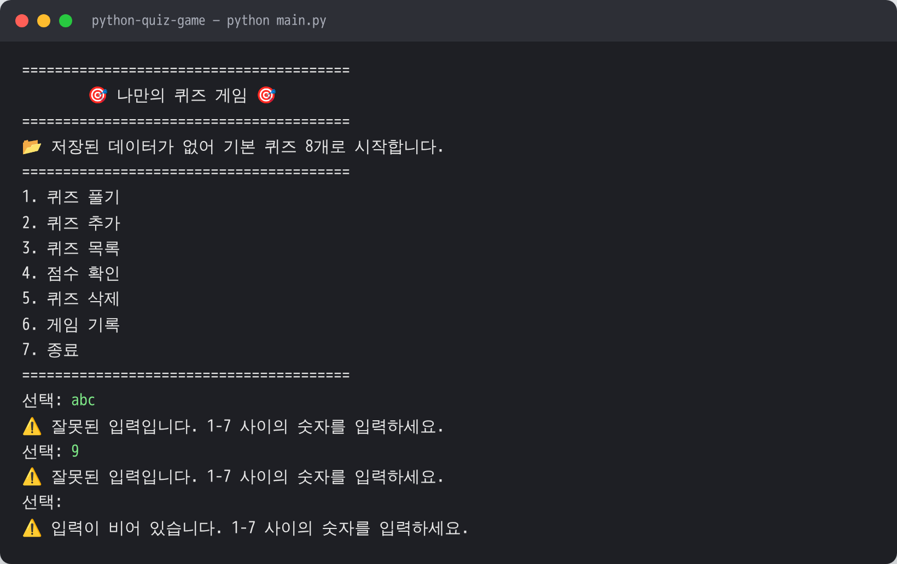
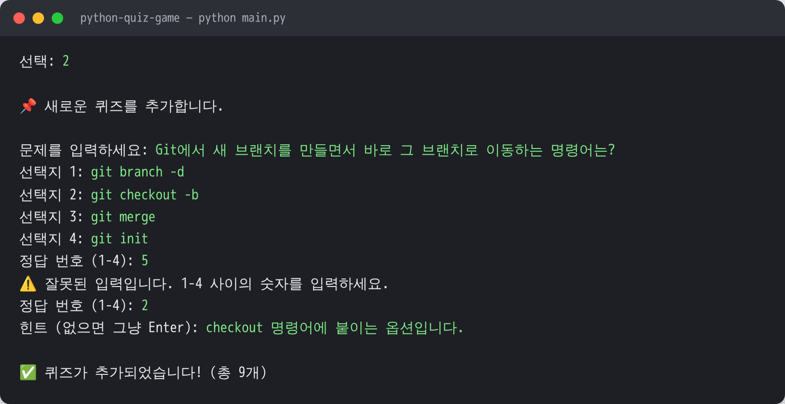
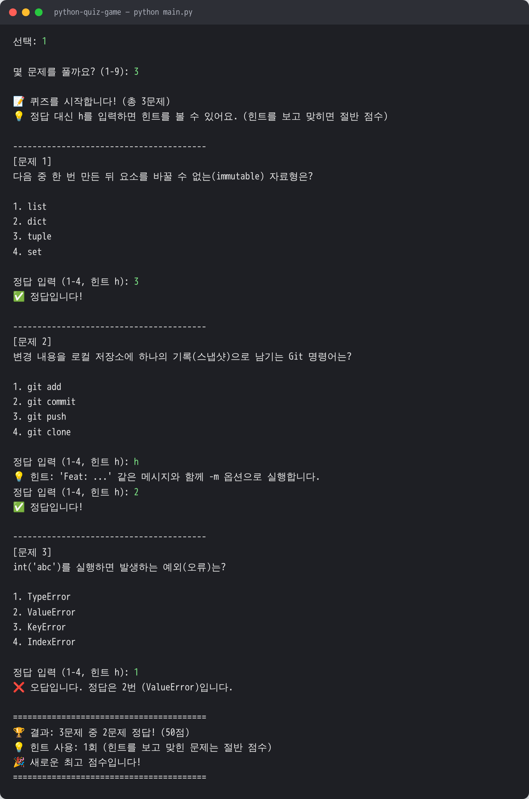
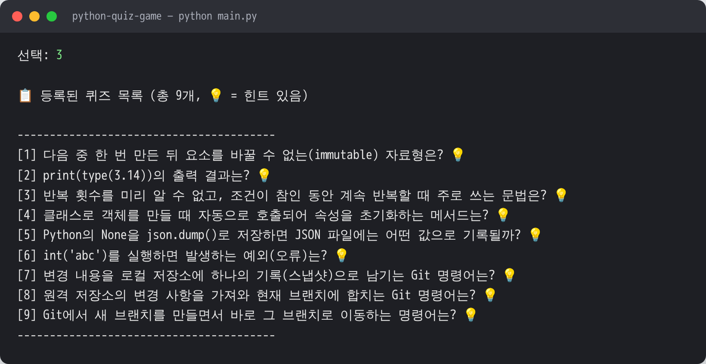
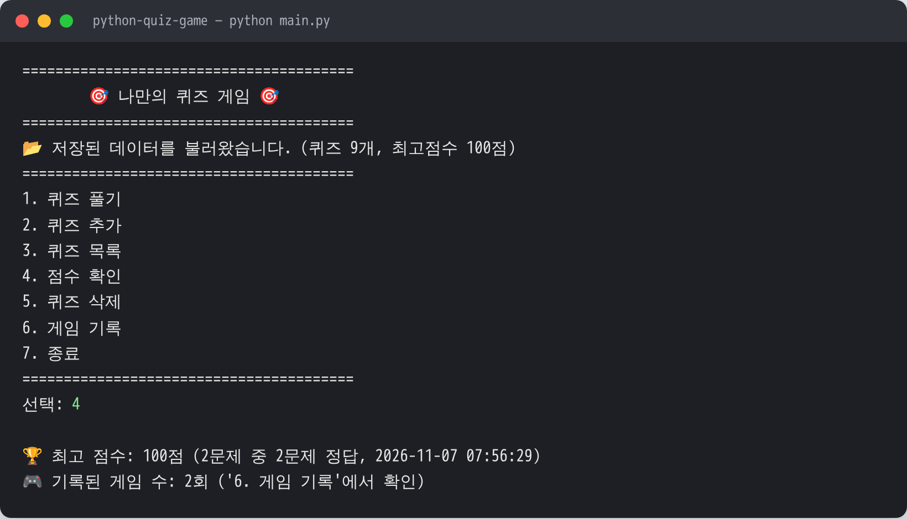
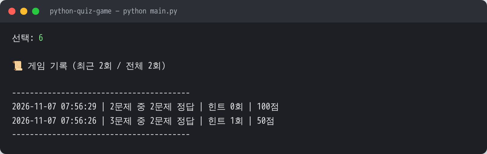
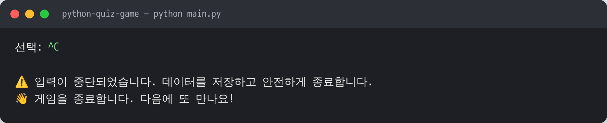

# 🎯 나만의 퀴즈 게임 (Python Quiz Game)

[](https://github.com/buildergarlic/python-quiz-game/actions/workflows/docker.yml)

터미널에서 동작하는 4지선다 퀴즈 게임입니다.
메뉴에서 번호를 골라 퀴즈를 풀고, 직접 퀴즈를 추가·삭제하고, 최고 점수와 게임 기록을 확인할 수 있습니다.
프로그램을 종료했다가 다시 실행해도 퀴즈와 점수는 `state.json` 파일에 저장되어 그대로 남아 있습니다.

## 1. 프로젝트 개요

| 항목 | 내용 |
|---|---|
| 형태 | Python 콘솔(터미널) 프로그램 |
| 개발 환경 | Python 3.10 이상 (3.10, 3.13에서 동작 확인), 외부 라이브러리 없음 (표준 라이브러리만 사용) |
| 핵심 구조 | `Quiz`(문제 1개), `QuizGame`(게임 흐름), `StateStorage`(파일 저장) 3개 클래스로 역할 분리 |
| 데이터 저장 | 프로젝트 루트의 `state.json` (UTF-8 JSON) |
| 버전 관리 | Git 기능 단위 커밋 + 기능 브랜치(`feature/*`) 작업 후 `main`에 병합 |
| 실행 환경 재현 | Docker 이미지(Python 3.12.16 고정)로 Windows·macOS·Linux 어디서나 같은 환경에서 실행, GitHub Actions로 push마다 자동 검사 ([9장](#9-docker-실행-가이드--어떤-개발-환경에서도-똑같이-재현하기)) |

## 2. 퀴즈 주제와 선정 이유

**주제: Python & Git 기초**

- **만드는 과정이 곧 복습이다.** 이 미션에서 배우는 자료형, 반복문, 클래스, JSON, 예외 처리, Git 명령어를 문제로 만들었습니다. 좋은 4지선다 문제를 내려면 정답뿐 아니라 오답 선택지가 *왜* 틀렸는지도 알아야 해서, 문제를 만드는 과정에서 개념을 한 번 더 정리할 수 있었습니다.
- **코드와 퀴즈가 서로를 설명한다.** `int('abc')`가 `ValueError`를 내는 것(숫자 입력 검증), `None`이 JSON에서 `null`로 저장되는 것(`best_score`) 등 이 게임을 만들면서 실제로 마주친 내용을 문제로 넣었습니다.
- **함께 쓸 수 있다.** 같은 과정을 밟는 동료들도 바로 풀어 보며 복습할 수 있는 주제입니다.

## 3. 실행 방법

두 가지 방법이 있습니다. **PC 환경과 상관없이 똑같이 실행하려면 방법 1(Docker)을 권장합니다.**

### 방법 1. Docker로 실행 (Python 설치 불필요, Windows·macOS·Linux 동일)

```bash
git clone https://github.com/buildergarlic/python-quiz-game.git
cd python-quiz-game
docker compose build
docker compose run --rm quiz
```

- Docker Desktop(또는 Docker Engine)만 설치되어 있으면 됩니다.
- 퀴즈와 점수는 Docker 볼륨에 저장되어, 컨테이너를 지우고 다시 실행해도 남아 있습니다.
- 설치 방법, OS별 명령어, 데이터 관리, 문제 해결은 [9. Docker 실행 가이드](#9-docker-실행-가이드--어떤-개발-환경에서도-똑같이-재현하기)에 모두 있습니다.

### 방법 2. Python으로 직접 실행

```bash
# 1) 저장소 복제
git clone https://github.com/buildergarlic/python-quiz-game.git
cd python-quiz-game

# 2) 실행 (Windows)
python main.py

# 2) 실행 (macOS / Linux)
python3 main.py
```

- Python 버전 확인: `python --version` (3.10 이상)
- 설치할 패키지는 없습니다.
- 처음 실행하면 기본 퀴즈 8개로 시작하고 `state.json`이 자동으로 만들어집니다.

## 4. 기능 목록

### 메뉴

| 번호 | 메뉴 | 설명 |
|:-:|---|---|
| 1 | 퀴즈 풀기 | 풀 문제 수를 고르면 **무작위 순서**로 출제합니다. 정답/오답을 바로 알려 주고, 다 풀면 결과와 최고 점수 갱신 여부를 보여 줍니다. |
| 2 | 퀴즈 추가 | 문제, 선택지 4개, 정답 번호(1-4), 힌트(선택)를 입력받아 등록하고 바로 저장합니다. |
| 3 | 퀴즈 목록 | 등록된 퀴즈를 번호와 함께 보여 줍니다. (💡 = 힌트 있음) |
| 4 | 점수 확인 | 최고 점수와 그 점수를 낸 게임의 정답 수·일시를 보여 줍니다. |
| 5 | 퀴즈 삭제 | 번호로 퀴즈를 골라 확인(y/n) 후 삭제하고 저장합니다. (0 = 취소) |
| 6 | 게임 기록 | 최근 10회 게임 기록(일시, 문제 수, 정답 수, 힌트 사용, 점수)을 최신순으로 보여 줍니다. |
| 7 | 종료 | 데이터를 저장하고 종료합니다. |

### 보너스 과제 구현

- [x] 랜덤 출제 — `random.sample()`로 원본 목록은 그대로 두고 무작위로 뽑기
- [x] 문제 수 선택 — 퀴즈 시작 시 1 ~ 전체 문제 수 중 선택
- [x] 힌트 기능 — 풀이 중 `h` 입력 시 힌트 표시, 힌트를 보고 맞힌 문제는 **절반 점수**
- [x] 퀴즈 삭제 기능
- [x] 점수 기록 히스토리 — 모든 게임 기록을 `state.json`에 저장

### 점수 계산

- 100점 만점, 문제당 배점 = `100 / 푼 문제 수`
- 힌트 없이 맞히면 배점 전부, 힌트를 보고 맞히면 배점의 50%, 틀리면 0점
- 예) 3문제 중 1개는 그냥 맞히고 1개는 힌트를 보고 맞히고 1개는 틀림 → (1 + 0.5 + 0) / 3 × 100 = **50점**
- 최고 점수는 이 점수(0~100) 기준으로 비교하며, 기존 최고 점수보다 **높을 때만** 갱신합니다.

### 입력 / 예외 처리

| 상황 | 처리 |
|---|---|
| 앞뒤 공백 (`" 1 "`) | 공백을 제거하고 `1`로 처리 |
| 숫자가 아님 (`abc`) | 안내 메시지 출력 후 다시 입력 |
| 범위 밖 숫자 (메뉴 `9`, 정답 `0`) | 안내 메시지 출력 후 다시 입력 |
| 빈 입력 (그냥 Enter) | 안내 메시지 출력 후 다시 입력 |
| 빈 문제/선택지, 중복 선택지 | 안내 메시지 출력 후 다시 입력 |
| `Ctrl+C` (KeyboardInterrupt), `Ctrl+D`/`Ctrl+Z` (EOFError) | 안내 메시지 → 데이터 저장 → 정상 종료 |
| `state.json` 없음 (첫 실행) | 기본 퀴즈 8개로 시작하고 파일 생성 |
| `state.json` 손상 (JSON 문법 오류, 필드 형식 오류) | `state.json.bak`으로 백업한 뒤 기본 데이터로 복구 |
| `state.json` 읽기 불가 (권한 등) | 기본 퀴즈로 시작하되, 원본을 덮어쓰지 않도록 그 실행에서는 저장하지 않음 |
| 저장 실패 (디스크·권한 문제) | 안내 메시지를 보여 주고 게임은 계속 진행 |

## 5. 파일 구조

```
python-quiz-game/
├── main.py              # 실행 진입점: StateStorage와 QuizGame을 만들어 게임 시작
├── quiz.py              # Quiz 클래스: 퀴즈 1문제 (출력, 정답 확인, 딕셔너리 변환/검증)
├── quiz_game.py         # QuizGame 클래스: 메뉴와 게임 전체 흐름 (풀기/추가/목록/점수/삭제/기록)
├── storage.py           # StateStorage 클래스: state.json 읽기·쓰기·형식 검증·백업
├── input_utils.py       # 공통 입력 함수: 숫자/문자열/y·n 입력 검증
├── default_quizzes.py   # 기본 퀴즈 8문제 (Python & Git 기초)
├── docs/
│   └── screenshots/     # 실행 화면 캡처
├── Dockerfile           # Docker 이미지 설계도 (Python 3.12.16 + 게임 코드)
├── compose.yaml         # Docker Compose 설정 (입력 연결, 데이터 볼륨)
├── .dockerignore        # 이미지에 넣지 않을 파일 목록
├── .github/workflows/
│   └── docker.yml       # push·PR마다 Docker 빌드·실행을 자동 검사 (GitHub Actions)
├── .gitignore
├── README.md
└── state.json           # 실행하면 자동 생성 (Git에는 올리지 않음)
```

### 클래스 역할

```
main.py
  └─ QuizGame(storage)            게임 진행 담당 — "무엇을 할지"
       ├─ quizzes: [Quiz, ...]    문제 데이터 — "문제 하나가 할 줄 아는 것"
       ├─ storage: StateStorage   파일 담당 — "어떻게 저장할지"
       └─ input_utils 함수들       입력 검증 담당
```

- `QuizGame`은 파일이 어떤 형식으로 저장되는지 몰라도 되고, `StateStorage`는 게임 규칙을 몰라도 됩니다. 저장 방식을 바꾸더라도 `storage.py`만 고치면 됩니다.

## 6. 데이터 파일 설명 (`state.json`)

| 항목 | 내용 |
|---|---|
| 경로 | 프로젝트 루트 (`main.py`와 같은 폴더). `main.py` 위치를 기준으로 경로를 만들기 때문에 어느 폴더에서 실행해도 같은 파일을 사용합니다. 환경 변수 `QUIZ_STATE_PATH`를 지정하면 그 경로를 씁니다. Docker는 이 값을 `/data/state.json`(볼륨)으로 지정합니다. ([9-4](#9-4-데이터statejson-관리) 참고) |
| 역할 | 퀴즈 목록, 최고 점수, 게임 기록을 저장해 프로그램을 다시 실행해도 유지되게 합니다. |
| 인코딩 | UTF-8 (`ensure_ascii=False`로 한글을 그대로 저장) |
| 저장 시점 | 첫 실행, 퀴즈 추가·삭제, 퀴즈 풀이 종료, 프로그램 종료(중단 포함) |
| Git 관리 | 각자 PC의 플레이 데이터이고 실행할 때마다 바뀌므로 `.gitignore`로 제외합니다. |

### 스키마

```json
{
    "quizzes": [
        {
            "question": "print(type(3.14))의 출력 결과는?",
            "choices": ["<class 'int'>", "<class 'float'>", "<class 'str'>", "<class 'double'>"],
            "answer": 2,
            "hint": "소수점이 있는 수를 '부동소수점(floating point) 수'라고 부릅니다."
        }
    ],
    "best_score": 80,
    "history": [
        {
            "played_at": "2026-11-07 14:03:12",
            "total": 5,
            "correct": 4,
            "hints_used": 0,
            "score": 80
        }
    ]
}
```

| 키 | 타입 | 설명 |
|---|---|---|
| `quizzes` | list | 퀴즈 목록 (필수) |
| `quizzes[].question` | str | 문제 (빈 문자열 불가) |
| `quizzes[].choices` | list[str] | 선택지 4개 |
| `quizzes[].answer` | int | 정답 번호 1~4 (선택지 순서 기준) |
| `quizzes[].hint` | str | 힌트, 없으면 `""` (생략 가능) |
| `best_score` | int 또는 null | 최고 점수 0~100, 아직 풀지 않았으면 `null` |
| `history` | list | 게임 기록 (생략 가능, 오래된 기록부터 순서대로) |
| `history[].played_at` | str | 게임을 마친 일시 `YYYY-MM-DD HH:MM:SS` |
| `history[].total` / `correct` | int | 푼 문제 수 / 맞힌 문제 수 |
| `history[].hints_used` | int | 힌트를 본 문제 수 |
| `history[].score` | int | 그 게임의 점수 |

### 함께 생기는 파일

- `state.json.bak` — `state.json`이 손상되었을 때 복구 직전에 원본을 복사해 둔 백업 파일
- `state.json.tmp` — 저장할 때 잠깐 쓰는 임시 파일. 내용을 끝까지 쓴 뒤 `os.replace()`로 `state.json`과 교체하므로, 저장 도중 프로그램이 멈춰도 기존 파일이 반쯤 쓰인 채로 망가지지 않습니다.

## 7. 실행 화면

| 메뉴 / 잘못된 입력 처리 | 퀴즈 추가 |
|---|---|
|  |  |

| 퀴즈 풀기 (힌트·오답 포함) | 퀴즈 목록 |
|---|---|
|  |  |

| 재실행 후 불러오기 + 점수 확인 | 게임 기록 | Ctrl+C 안전 종료 |
|---|---|---|
|  |  |  |

## 8. Git 작업 흐름

- **커밋 메시지 규칙**: `Feat`(기능), `Refactor`(구조 개선), `Docs`(문서), `Chore`(설정) + 제목에 변경 요약, 본문에 세부 변경 사항
- **브랜치**
  - `main` — 항상 실행 가능한 상태 유지
  - `feature/play-quiz` — 퀴즈 풀기 기능 개발 후 `main`에 병합
  - `feature/bonus` — 보너스 기능(랜덤, 문제 수 선택, 힌트, 삭제, 기록) 개발 후 `main`에 병합
  - 병합은 `git merge --no-ff`로 수행해 `git log --graph`에서 브랜치 작업 흔적이 보이도록 했습니다.

| 명령어 | 이 프로젝트에서 사용한 곳 |
|---|---|
| `git init` | 프로젝트 폴더를 Git 저장소로 만들기 |
| `git add` / `git commit` | 기능 하나를 완성할 때마다 변경 파일을 스테이징하고 기록 |
| `git checkout -b` / `git checkout` | 기능 브랜치를 만들어 이동, 작업 후 `main`으로 복귀 |
| `git merge` | 기능 브랜치를 `main`에 병합 |
| `git push` | 로컬 커밋을 GitHub 원격 저장소에 업로드 |
| `git clone` | 원격 저장소를 다른 폴더에 복제 (복제 실습) |
| `git pull` | 복제본에서 올린 변경 사항을 기존 작업 폴더로 가져오기 (복제 실습) |

## 9. Docker 실행 가이드 — 어떤 개발 환경에서도 똑같이 재현하기

### 9-1. 왜 Docker를 쓰나요?

- 이 게임을 그냥 실행하려면 PC에 Python 3.10 이상이 있어야 합니다. 그런데 PC마다 OS, Python 버전, 문자 인코딩이 달라서 "내 PC에서는 되는데 다른 PC에서는 안 되는" 일이 생깁니다.
- Docker는 **Linux + Python 3.12.16 + 게임 코드**를 하나의 이미지로 묶습니다. 누가 어떤 OS에서 실행해도 컨테이너 안은 똑같은 환경입니다.
- PC에 Python을 설치하지 않아도 됩니다. Docker만 있으면 됩니다.

| 용어 | 뜻 |
|---|---|
| 이미지 | 실행 환경과 코드를 묶은 '설치본'. `Dockerfile`로 만듭니다. |
| 컨테이너 | 이미지를 실행한 것. 게임 한 번 = 컨테이너 하나. 끝나면 지워도 됩니다. |
| 볼륨 | 컨테이너를 지워도 남는 저장 공간. `state.json`을 여기에 보관합니다. |

### 9-2. 준비물

| OS | 설치할 것 |
|---|---|
| Windows 10/11 | Docker Desktop (설치 중 WSL 2 사용 선택) |
| macOS (Intel / Apple Silicon) | Docker Desktop |
| Linux | Docker Engine + Docker Compose 플러그인 |

- 설치 안내: https://docs.docker.com/get-started/get-docker/ (Linux: https://docs.docker.com/engine/install/)
- Windows·macOS는 **Docker Desktop을 실행해 둔 상태**에서 명령어를 입력합니다.
- 설치 확인:

```bash
docker --version
docker compose version
```

### 9-3. 실행하기

#### 방법 A. Docker Compose (권장)

```bash
git clone https://github.com/buildergarlic/python-quiz-game.git
cd python-quiz-game
docker compose build          # 이미지 만들기 (처음 한 번, 코드가 바뀔 때마다)
docker compose run --rm quiz  # 게임 실행
```

- `run --rm`: 게임이 끝나면 컨테이너를 지웁니다. 데이터는 볼륨(`python-quiz-game_quiz-data`)에 남습니다.
- `docker compose up`은 쓰지 않습니다. `up`은 서버를 백그라운드로 띄우는 용도라 키보드 입력을 주고받기 어렵습니다.

#### 방법 B. docker 명령어만 사용

```bash
docker build -t python-quiz-game .
docker run --rm -it -v quiz-data:/data python-quiz-game
```

| 옵션 | 뜻 |
|---|---|
| `-t python-quiz-game` (build) | 만든 이미지에 이름을 붙입니다. |
| `--rm` | 게임이 끝나면 컨테이너를 지웁니다. |
| `-it` | `-i` 키보드 입력 + `-t` 터미널 화면. 빠지면 입력할 수 없습니다. |
| `-v quiz-data:/data` | `quiz-data` 볼륨을 컨테이너의 `/data`에 연결해 `state.json`을 보관합니다. |

> 방법 A의 볼륨(`python-quiz-game_quiz-data`)과 방법 B의 볼륨(`quiz-data`)은 서로 다른 저장 공간입니다. 한 가지 방법을 계속 쓰세요.

**종료:** 메뉴 `7`, `Ctrl+C`, 다른 터미널에서 `docker stop` 모두 **데이터를 저장한 뒤** 정상 종료합니다. (`docker stop`은 Dockerfile의 `STOPSIGNAL SIGINT` 설정으로 Ctrl+C와 같은 신호를 보냅니다.)

### 9-4. 데이터(state.json) 관리

| 하고 싶은 일 | 방법 A (Compose) | 방법 B (docker) |
|---|---|---|
| 저장된 내용 보기 | `docker compose run --rm -T quiz cat /data/state.json` | `docker run --rm -v quiz-data:/data python-quiz-game cat /data/state.json` |
| 볼륨 목록 보기 | `docker volume ls` | `docker volume ls` |
| 처음 상태로 초기화 (데이터 삭제) | `docker compose down -v` | `docker volume rm quiz-data` |

**내 PC 폴더에 `state.json`을 두고 싶을 때** (파일을 직접 열어 보거나 백업할 때)

먼저 프로젝트 폴더 안에 `data` 폴더를 만듭니다: `mkdir data`

| 환경 | 명령 |
|---|---|
| macOS | `docker compose run --rm -v "$(pwd)/data:/data" quiz` |
| Linux | `docker compose run --rm --user "$(id -u):$(id -g)" -v "$(pwd)/data:/data" quiz` |
| Windows PowerShell | `docker compose run --rm -v "${PWD}/data:/data" quiz` |
| Windows 명령 프롬프트(cmd) | `docker compose run --rm -v "%cd%\data:/data" quiz` |

- Linux에서 `--user`를 붙이는 이유: 컨테이너 안 사용자(uid 1000)와 폴더 주인이 다르면 `⚠️ 데이터를 파일에 저장하지 못했습니다: Permission denied`가 나옵니다. `--user`로 내 계정과 같은 사용자로 실행하면 해결됩니다. (Docker Desktop은 권한을 자동으로 맞춰 줍니다.)
- `data/state.json`은 `.gitignore`의 `state.json` 규칙 때문에 Git에 올라가지 않습니다.

### 9-5. 운영체제별 차이

| 환경 | 게임 실행 명령 | 현재 폴더 표기 | 참고 |
|---|---|---|---|
| macOS / Linux 터미널 | `docker compose run --rm quiz` | `$(pwd)` | |
| Windows PowerShell / Windows Terminal (권장) | `docker compose run --rm quiz` | `${PWD}` | |
| Windows 명령 프롬프트(cmd) | `docker compose run --rm quiz` | `%cd%` | 한글이 깨지면 `chcp 65001` 실행 후 다시 시작 |
| Windows Git Bash | `winpty docker compose run --rm quiz` | `$(pwd)` | 입력이 안 되면 `winpty`를 앞에 붙입니다. 권장하지 않습니다. |

- Apple Silicon(M1~M4) Mac에서도 그대로 동작합니다. 공식 Python 이미지가 arm64를 지원하고, GitHub Actions에서 arm64 실행을 매번 확인합니다.

### 9-6. 재현 확인 체크리스트

아래 결과가 그대로 나오면 이 프로젝트가 여러분의 PC에서 똑같이 재현된 것입니다.

| 순서 | 명령 / 동작 | 기대 결과 |
|:-:|---|---|
| 1 | `docker compose build` | `Image python-quiz-game Built` |
| 2 | `docker compose run --rm -T quiz python --version` | `Python 3.12.16` |
| 3 | `docker compose run --rm quiz` (처음 실행) | `📂 저장된 데이터가 없어 기본 퀴즈 8개로 시작합니다.` |
| 4 | 메뉴 `2`로 퀴즈 1개 추가 → `7` 종료 → 3번 명령 다시 실행 | `📂 저장된 데이터를 불러왔습니다. (퀴즈 9개, ...)` |
| 5 | 입력 없이 자동 확인: `printf '7\n' \| docker compose run --rm -T quiz` (PowerShell: `"7" \| docker compose run --rm -T quiz`) | 메뉴 출력 후 `👋 게임을 종료합니다. 다음에 또 만나요!` |
| 6 | 처음 상태로 되돌리기: `docker compose down -v` | `Volume python-quiz-game_quiz-data Removed` |

### 9-7. 다른 Python 버전으로 실행해 보기

과제 기준 최소 버전(Python 3.10)에서도 똑같이 동작하는지 확인할 수 있습니다.

```bash
docker build --build-arg PYTHON_VERSION=3.10 -t python-quiz-game:py3.10 .
docker run --rm -it -v quiz-data:/data python-quiz-game:py3.10
```

### 9-8. 함께 작업하기

| 상황 | 할 일 |
|---|---|
| 처음 프로젝트에 참여 | `git clone` → `docker compose build` → `docker compose run --rm quiz` |
| 다른 사람이 코드를 바꿔 push함 | `git pull` → `docker compose build` → `docker compose run --rm quiz` (이미지는 빌드할 때의 코드를 담고 있어서, 코드가 바뀌면 **다시 빌드**해야 합니다) |
| 코드를 고치면서 바로 확인 | `docker compose run --rm -v "$(pwd):/app" quiz` — 내 폴더의 코드를 컨테이너에 연결해 다시 빌드하지 않고 실행합니다. |
| 변경 사항을 올림 (push / Pull Request) | GitHub Actions가 자동으로 Docker 이미지를 빌드하고 실행해 봅니다. 위 배지와 PR의 체크 표시가 초록색이면 재현성이 유지된 것입니다. |

- 각자의 플레이 기록(`state.json`)은 각자의 볼륨에만 저장되고 Git으로 공유되지 않습니다.
- 자동 검사(`.github/workflows/docker.yml`) 내용: 이미지 빌드, 첫 실행, 데이터 유지, `docker stop` 시 저장, Python 3.10 빌드, Docker Compose 실행, arm64 빌드·실행

### 9-9. 문제 해결

| 증상 | 원인 | 해결 |
|---|---|---|
| `Cannot connect to the Docker daemon` / `error during connect` | Docker가 실행 중이 아님 | Docker Desktop을 실행하고 다시 시도 |
| `the input device is not a TTY` | `-it` 없이 실행했거나 Git Bash 사용 | `-it`를 붙이거나, PowerShell을 쓰거나, 명령 앞에 `winpty` |
| 메뉴는 나오는데 입력이 안 됨 | `-i` 옵션이 빠짐 | `docker run --rm -it ...` |
| 한글·이모지가 깨짐 (Windows) | 콘솔 문자 코드가 UTF-8이 아님 | Windows Terminal 사용, 또는 `chcp 65001` 실행 후 다시 시작 |
| 다시 실행했더니 퀴즈·점수가 사라짐 | `-v` 옵션 빠짐, 방법 A·B를 섞어 씀, `down -v` 실행 | 9-3, 9-4 참고 |
| `⚠️ 데이터를 파일에 저장하지 못했습니다: Permission denied` | Linux에서 내 PC 폴더를 연결했고 폴더 주인이 다름 | `--user "$(id -u):$(id -g)"` 추가 |
| 코드를 고쳤는데 반영되지 않음 | 이미지를 다시 빌드하지 않음 | `docker compose build` |

### 9-10. Docker 관련 파일 설명

| 파일 | 역할 |
|---|---|
| `Dockerfile` | 이미지 설계도. `python:3.12.16-slim` 위에 게임 코드를 복사하고, UTF-8 입출력, 일반 사용자(`quiz`, uid 1000)로 실행, 데이터 경로 `QUIZ_STATE_PATH=/data/state.json`, `docker stop` 시 SIGINT를 설정합니다. 외부 라이브러리가 없어 `pip install` 단계가 없습니다. |
| `compose.yaml` | `docker compose` 설정. 입력 연결(`stdin_open`, `tty`)과 `quiz-data` 볼륨 연결을 적어 두어 짧은 명령으로 실행합니다. |
| `.dockerignore` | `.git`, `state.json`, 문서 등 이미지에 필요 없는 파일을 빼서 빌드를 빠르게 하고 내 PC의 데이터가 이미지에 섞이지 않게 합니다. |
| `.github/workflows/docker.yml` | push·PR마다 GitHub 서버에서 위 체크리스트를 자동으로 실행합니다. |
