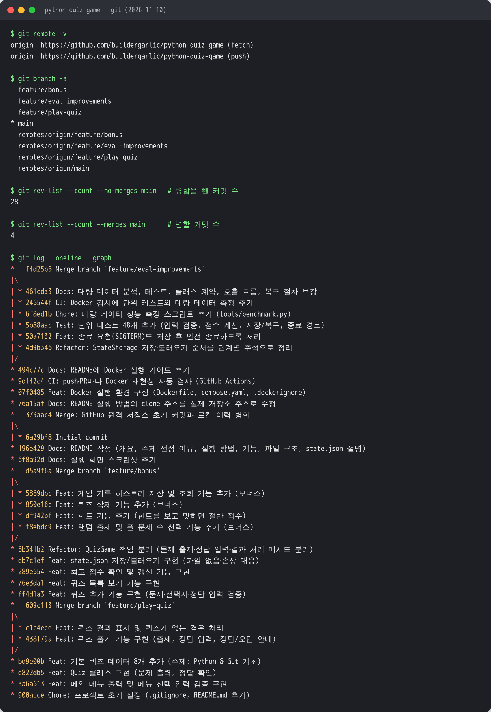

# 🎯 나만의 퀴즈 게임 (Python Quiz Game)

[](https://github.com/buildergarlic/python-quiz-game/actions/workflows/docker.yml)

> **코디세이 AI 올인원 과정 · Windows 11 사용자 안내**  
> 처음 설치하는 분은 [12. 완전 초보를 위한 설치부터 따라하기 플레이북](#12-완전-초보를-위한-설치부터-따라하기-플레이북)부터 시작하세요. 클릭할 위치, 복사할 명령어, 단계별 성공 확인까지 순서대로 안내합니다.

터미널에서 동작하는 4지선다 퀴즈 게임입니다.
메뉴에서 번호를 골라 퀴즈를 풀고, 직접 퀴즈를 추가·삭제하고, 최고 점수와 게임 기록을 확인할 수 있습니다.
프로그램을 종료했다가 다시 실행해도 퀴즈와 점수는 `state.json` 파일에 저장되어 그대로 남아 있습니다.

## 1. 프로젝트 개요

| 항목 | 내용 |
|---|---|
| 형태 | Python 콘솔(터미널) 프로그램 |
| 개발 환경 | Python 3.10 이상 (3.10, 3.13에서 동작 확인), 외부 라이브러리 없음 (표준 라이브러리만 사용) |
| 핵심 구조 | `Quiz`(문제 1개), `QuizGame`(게임 흐름), `StateStorage`(파일 저장) 3개 클래스로 역할 분리 |
| 데이터 저장 | 프로젝트 루트의 `state.json` (UTF-8 JSON) |
| 버전 관리 | Git 기능 단위 커밋 + 기능 브랜치(`feature/*`) 작업 후 `main`에 병합 |
| 실행 환경 재현 | Docker 이미지(Python 3.12.16 고정)로 Windows·macOS·Linux 어디서나 같은 환경에서 실행, GitHub Actions로 push마다 자동 검사 ([9장](#9-docker-실행-가이드--어떤-개발-환경에서도-똑같이-재현하기)) |
| 원격 저장소 | <https://github.com/buildergarlic/python-quiz-game> — 커밋 수·브랜치 병합 그래프 증빙은 [8장](#8-git-작업-흐름) |
| 테스트 | 단위 테스트 48개 (`tests/`), push마다 Python 3.12.16·3.10에서 자동 실행 ([10장](#10-테스트)) |
| 대량 데이터 | 퀴즈 1,000~100,000개 실측과 한계·개선안 ([11장](#11-대량-데이터퀴즈-1000개-이상-한계-분석과-개선안)) |

## 2. 퀴즈 주제와 선정 이유

**주제: Python & Git 기초**

- **만드는 과정이 곧 복습이다.** 이 미션에서 배우는 자료형, 반복문, 클래스, JSON, 예외 처리, Git 명령어를 문제로 만들었습니다. 좋은 4지선다 문제를 내려면 정답뿐 아니라 오답 선택지가 *왜* 틀렸는지도 알아야 해서, 문제를 만드는 과정에서 개념을 한 번 더 정리할 수 있었습니다.
- **코드와 퀴즈가 서로를 설명한다.** `int('abc')`가 `ValueError`를 내는 것(숫자 입력 검증), `None`이 JSON에서 `null`로 저장되는 것(`best_score`) 등 이 게임을 만들면서 실제로 마주친 내용을 문제로 넣었습니다.
- **함께 쓸 수 있다.** 같은 과정을 밟는 동료들도 바로 풀어 보며 복습할 수 있는 주제입니다.

## 3. 실행 방법

Windows 11에서 Docker를 처음 사용하는 과정 참여자는 [12장 설치부터 따라하기 플레이북](#12-완전-초보를-위한-설치부터-따라하기-플레이북)을 이용하세요.

두 가지 방법이 있습니다. **PC 환경과 상관없이 똑같이 실행하려면 방법 1(Docker)을 권장합니다.**

### 방법 1. Docker로 실행 (Python 설치 불필요, Windows·macOS·Linux 동일)

```bash
git clone https://github.com/buildergarlic/python-quiz-game.git
cd python-quiz-game
docker compose build
docker compose run --rm quiz
```

- Docker Desktop(또는 Docker Engine)만 설치되어 있으면 됩니다.
- 퀴즈와 점수는 Docker 볼륨에 저장되어, 컨테이너를 지우고 다시 실행해도 남아 있습니다.
- 설치 방법, OS별 명령어, 데이터 관리, 문제 해결은 [9. Docker 실행 가이드](#9-docker-실행-가이드--어떤-개발-환경에서도-똑같이-재현하기)에 모두 있습니다.

### 방법 2. Python으로 직접 실행

```bash
# 1) 저장소 복제
git clone https://github.com/buildergarlic/python-quiz-game.git
cd python-quiz-game

# 2) 실행 (Windows)
python main.py

# 2) 실행 (macOS / Linux)
python3 main.py
```

- Python 버전 확인: `python --version` (3.10 이상)
- 설치할 패키지는 없습니다.
- 처음 실행하면 기본 퀴즈 8개로 시작하고 `state.json`이 자동으로 만들어집니다.
- 테스트 실행: `python -m unittest discover -s tests -v` ([10장](#10-테스트))

## 4. 기능 목록

### 메뉴

| 번호 | 메뉴 | 설명 |
|:-:|---|---|
| 1 | 퀴즈 풀기 | 풀 문제 수를 고르면 **무작위 순서**로 출제합니다. 정답/오답을 바로 알려 주고, 다 풀면 결과와 최고 점수 갱신 여부를 보여 줍니다. |
| 2 | 퀴즈 추가 | 문제, 선택지 4개, 정답 번호(1-4), 힌트(선택)를 입력받아 등록하고 바로 저장합니다. |
| 3 | 퀴즈 목록 | 등록된 퀴즈를 번호와 함께 보여 줍니다. (💡 = 힌트 있음) |
| 4 | 점수 확인 | 최고 점수와 그 점수를 낸 게임의 정답 수·일시를 보여 줍니다. |
| 5 | 퀴즈 삭제 | 번호로 퀴즈를 골라 확인(y/n) 후 삭제하고 저장합니다. (0 = 취소) |
| 6 | 게임 기록 | 최근 10회 게임 기록(일시, 문제 수, 정답 수, 힌트 사용, 점수)을 최신순으로 보여 줍니다. |
| 7 | 종료 | 데이터를 저장하고 종료합니다. |

### 보너스 과제 구현

- [x] 랜덤 출제 — `random.sample()`로 원본 목록은 그대로 두고 무작위로 뽑기
- [x] 문제 수 선택 — 퀴즈 시작 시 1 ~ 전체 문제 수 중 선택
- [x] 힌트 기능 — 풀이 중 `h` 입력 시 힌트 표시, 힌트를 보고 맞힌 문제는 **절반 점수**
- [x] 퀴즈 삭제 기능
- [x] 점수 기록 히스토리 — 모든 게임 기록을 `state.json`에 저장

### 점수 계산

- 100점 만점, 문제당 배점 = `100 / 푼 문제 수`
- 힌트 없이 맞히면 배점 전부, 힌트를 보고 맞히면 배점의 50%, 틀리면 0점
- 예) 3문제 중 1개는 그냥 맞히고 1개는 힌트를 보고 맞히고 1개는 틀림 → (1 + 0.5 + 0) / 3 × 100 = **50점**
- 최고 점수는 이 점수(0~100) 기준으로 비교하며, 기존 최고 점수보다 **높을 때만** 갱신합니다.

### 입력 / 예외 처리

| 상황 | 처리 |
|---|---|
| 앞뒤 공백 (`" 1 "`) | 공백을 제거하고 `1`로 처리 |
| 숫자가 아님 (`abc`) | 안내 메시지 출력 후 다시 입력 |
| 범위 밖 숫자 (메뉴 `9`, 정답 `0`) | 안내 메시지 출력 후 다시 입력 |
| 빈 입력 (그냥 Enter) | 안내 메시지 출력 후 다시 입력 |
| 빈 문제/선택지, 중복 선택지 | 안내 메시지 출력 후 다시 입력 |
| `Ctrl+C` (KeyboardInterrupt), `Ctrl+D`/`Ctrl+Z` (EOFError) | 안내 메시지 → 데이터 저장 → 정상 종료 |
| 종료 요청 신호 `SIGTERM` (`kill <PID>`, 서비스 관리자) | `main.py`의 `handle_terminate()`가 `KeyboardInterrupt`로 바꿔 Ctrl+C와 같은 경로로 저장 후 종료 (종료 코드 0). 저장 중에 다시 오면 무시해 저장이 끊기지 않음 |
| `state.json` 없음 (첫 실행) | 기본 퀴즈 8개로 시작하고 파일 생성 |
| `state.json` 손상 (JSON 문법 오류, 필드 형식 오류) | `state.json.bak`으로 백업한 뒤 기본 데이터로 복구 |
| `state.json` 읽기 불가 (권한 등) | 기본 퀴즈로 시작하되, 원본을 덮어쓰지 않도록 그 실행에서는 저장하지 않음 |
| 저장 실패 (디스크·권한 문제) | 안내 메시지를 보여 주고 게임은 계속 진행 (아래 복구 절차 참고) |

### 저장·불러오기 오류가 났을 때 복구 절차

저장은 항상 **메모리에 있는 전체 데이터**를 임시 파일에 쓴 뒤 `state.json`과 바꿔 끼웁니다. 그래서 저장이 실패해도 `state.json`에는 마지막으로 성공한 내용이 온전히 남아 있고, 원인을 고친 뒤 다음 저장(퀴즈 추가·삭제, 풀이 종료, 메뉴 `7` 종료)이 성공하면 그동안의 변경이 한꺼번에 저장됩니다.

| 화면에 나온 안내 | 원인 | 할 일 |
|---|---|---|
| `⚠️ 데이터를 파일에 저장하지 못했습니다: [Errno 13] Permission denied` | `state.json`이나 그 폴더에 쓰기 권한이 없음 | 프로그램을 끄지 말고 다른 터미널에서 권한을 고칩니다. macOS/Linux: `chmod u+w state.json` (폴더면 `chmod u+w .`), Windows: 파일 속성에서 '읽기 전용' 해제. 그다음 메뉴 `7`로 종료하면 저장됩니다. |
| `⚠️ 데이터를 파일에 저장하지 못했습니다: [Errno 28] No space left on device` | 디스크가 가득 참 | 공간을 확보한 뒤 메뉴 `7`로 종료합니다. |
| `⚠️ state.json을 불러오지 못해 기본 퀴즈로 시작합니다. (기존 파일을 보호하기 위해 이번 실행에서는 저장하지 않습니다.)` | 읽기 권한이 없거나 `state.json` 자리에 폴더가 있음 | 원본을 지키기 위해 이번 실행은 저장하지 않습니다. 종료 후 권한을 고치고(`chmod u+rw state.json`) 다시 실행합니다. |
| `⚠️ state.json이 손상되어 기본 퀴즈 데이터로 복구했습니다. (손상된 파일은 state.json.bak에 백업해 두었습니다.)` | JSON 문법 오류나 형식 오류 (예: 정답이 `true`) | 프로그램을 끈 뒤 `state.json.bak`을 열어 잘못된 부분을 고치고, `state.json`으로 이름을 바꿔 덮어쓴 다음 다시 실행합니다. |

- **백업 보존 정책**: 백업 파일은 `state.json.bak` **1개만** 유지합니다. 손상이 다시 생기면 이전 백업을 새 손상 파일로 덮어씁니다. 그래서 복구 안내가 나오면 다음 실행 전에 `.bak`을 확인하거나 다른 이름으로 복사해 두세요. 백업에 실패하면(권한 등) 기본값으로 덮어쓰지 않고 그 실행에서는 저장을 끕니다.
- **사용자 알림**: 복구·저장 실패·저장 중지는 모두 첫 화면이나 해당 시점에 `⚠️` 메시지로 알리고, 백업 파일 이름을 함께 보여 줍니다.
- **동시 실행**: 같은 `state.json`으로 프로그램을 두 개 동시에 실행하면 나중에 저장한 쪽의 내용이 남습니다(파일 잠금 없음). 파일이 깨지지는 않지만(교체 방식) 먼저 저장한 쪽의 변경은 사라질 수 있으니 한 번에 하나만 실행하세요. 잠금이 필요한 규모라면 [11장](#11-대량-데이터퀴즈-1000개-이상-한계-분석과-개선안)의 SQLite 전환안을 따릅니다.

## 5. 파일 구조

```
python-quiz-game/
├── main.py              # 실행 진입점: StateStorage와 QuizGame을 만들어 게임 시작
├── quiz.py              # Quiz 클래스: 퀴즈 1문제 (출력, 정답 확인, 딕셔너리 변환/검증)
├── quiz_game.py         # QuizGame 클래스: 메뉴와 게임 전체 흐름 (풀기/추가/목록/점수/삭제/기록)
├── storage.py           # StateStorage 클래스: state.json 읽기·쓰기·형식 검증·백업
├── input_utils.py       # 공통 입력 함수: 숫자/문자열/y·n 입력 검증
├── default_quizzes.py   # 기본 퀴즈 8문제 (Python & Git 기초)
├── tests/               # 단위 테스트 48개 (python -m unittest discover -s tests -v)
│   ├── helpers.py           # 가짜 저장소, 입력 흉내 내기
│   ├── test_input_utils.py  # 입력 검증
│   ├── test_quiz.py         # Quiz 클래스, 기본 퀴즈 데이터
│   ├── test_scoring.py      # 점수 계산, 힌트, 최고 점수, 기록
│   ├── test_storage.py      # state.json 저장·불러오기·손상 복구
│   └── test_exit.py         # main.py를 실제 실행해 종료 경로(메뉴, Ctrl+C, SIGTERM) 확인
├── tools/
│   └── benchmark.py     # 퀴즈 1,000~100,000개 성능 측정 (11장)
├── docs/
│   └── screenshots/     # 실행 화면 캡처, Git 그래프 캡처
├── Dockerfile           # Docker 이미지 설계도 (Python 3.12.16 + 게임 코드)
├── compose.yaml         # Docker Compose 설정 (입력 연결, 데이터 볼륨)
├── .dockerignore        # 이미지에 넣지 않을 파일 목록
├── .github/workflows/
│   └── docker.yml       # push·PR마다 Docker 빌드·실행을 자동 검사 (GitHub Actions)
├── .gitignore
├── README.md
└── state.json           # 실행하면 자동 생성 (Git에는 올리지 않음)
```

### 클래스 역할

```
main.py
  └─ QuizGame(storage)            게임 진행 담당 — "무엇을 할지"
       ├─ quizzes: [Quiz, ...]    문제 데이터 — "문제 하나가 할 줄 아는 것"
       ├─ storage: StateStorage   파일 담당 — "어떻게 저장할지"
       └─ input_utils 함수들       입력 검증 담당
```

- `QuizGame`은 파일이 어떤 형식으로 저장되는지 몰라도 되고, `StateStorage`는 게임 규칙을 몰라도 됩니다. 저장 방식을 바꾸더라도 `storage.py`만 고치면 됩니다.

### 클래스·함수별 핵심 메서드 (입력 → 출력)

| 클래스 / 모듈 | 메서드 | 입력 → 출력 | 책임 |
|---|---|---|---|
| `Quiz` | `Quiz(question, choices, answer, hint="")` | 문제 str, 선택지 list[str] 4개, 정답 int 1~4, 힌트 str → 객체 | 문제 1개의 데이터 보관 |
| | `display(number)` | 화면 번호 int → 없음 (출력) | 문제와 선택지를 번호와 함께 출력 |
| | `is_correct(choice_number)` | 고른 번호 int → bool | 정답 여부 판단 |
| | `to_dict()` / `Quiz.from_dict(data)` | Quiz ↔ dict | 저장용 변환. `from_dict`는 형식이 틀리면 `ValueError` |
| `QuizGame` | `run()` | 없음 → 없음 | 불러오기 → 메뉴 반복 → 저장 후 종료. Ctrl+C·입력 종료·SIGTERM을 한곳에서 처리 |
| | `play_quiz()`, `add_quiz()`, `list_quizzes()`, `show_score()`, `delete_quiz()`, `show_history()` | 없음 → 없음 | 메뉴 1~6 기능. 데이터를 바꾸는 기능은 끝에서 `save_state()` 호출 |
| | `load_state()` | 없음 → 첫 화면 안내 str | `StateStorage.load()` 결과(정상·없음·손상·읽기 불가)에 따라 데이터 준비 |
| | `save_state()` | 없음 → bool (성공 여부) | `StateStorage.save()` 호출, 실패하면 안내만 하고 게임 계속 |
| `StateStorage` | `load()` | 없음 → `(상태, 데이터)` | 상태는 `"loaded"`·`"missing"`·`"corrupted"`·`"error"`, 데이터는 `{"quizzes": [Quiz], "best_score": int 또는 None, "history": [dict]}` 또는 `None` |
| | `save(quizzes, best_score, history)` | 퀴즈 목록, 최고 점수, 기록 → 없음 | 임시 파일에 쓰고 `os.replace`로 교체. 실패하면 `OSError` |
| | `backup_corrupted_file()` | 없음 → bool | 손상 파일을 `state.json.bak`으로 복사 |
| `input_utils` | `parse_int(raw, min_value, max_value)` | 입력 문자열 → `(정수, None)` 또는 `(None, 안내 문구)` | 공백 제거, 빈 입력·숫자 아님·범위 밖 판별 (화면 입출력 없음 → 테스트하기 쉬움) |
| | `read_int()`, `read_text()`, `read_yes_no()` | 안내 문구 → int / str / bool | 올바른 값이 들어올 때까지 다시 묻기 |

### 호출 흐름 (입력 → 게임 → 저장)

메뉴 `2. 퀴즈 추가`를 예로 들면 다음 순서로 호출됩니다.

```
[키보드] "2"
   │
   ▼
input_utils.read_int("선택: ", 1, 7) ──(abc, 9, 빈 입력)──▶ 안내 후 다시 입력
   │ 2
   ▼
QuizGame.handle_menu(2) ─▶ QuizGame.add_quiz()
   │   read_text() / read_int()로 문제·선택지 4개·정답 입력 → Quiz(...) 생성 → self.quizzes에 추가
   ▼
QuizGame.save_state() ──(can_save가 False)──▶ 저장하지 않음 (원본 보호)
   │ quizzes, best_score, history
   ▼
StateStorage.save() ─▶ state.json.tmp에 쓰기 ─▶ os.replace() ─▶ state.json
   └──(OSError)──▶ save_state()가 "⚠️ 저장하지 못했습니다" 출력, 게임은 계속
```

| 시점 | 호출 순서 |
|---|---|
| 시작 | `main()` → `QuizGame(StateStorage(경로)).run()` → `load_state()` → `StateStorage.load()` → 상태별 처리 → 메뉴 |
| 종료 | 메뉴 `7` / Ctrl+C / Ctrl+D·Ctrl+Z / SIGTERM → `run()`의 반복 탈출 또는 `except` → `save_state()` → 종료 메시지 |

### 저장 방식을 바꾸고 싶을 때 (확장 시나리오)

| 바꾸려는 것 | 고칠 곳 | 그대로인 곳 |
|---|---|---|
| 파일 형식만 변경 (예: 퀴즈 파일과 기록 파일 분리, 들여쓰기 없는 JSON) | `load()`/`save()` 약속을 지키는 새 저장 클래스 작성, `main.py`에서 바꿔 끼우기 | `QuizGame`, `Quiz`, `input_utils` |
| SQLite 같은 DB로 전환 (퀴즈 수만 개 이상) | 저장 클래스를 `add`/`delete`/`page`/`search`/`sample` 단위로 바꾸고, `QuizGame`의 목록·삭제·출제가 전체 목록 대신 이 메서드를 호출하도록 수정 | `Quiz`, `input_utils`, 메뉴 구성 |

DB 전환이 왜, 언제 필요한지는 [11장](#11-대량-데이터퀴즈-1000개-이상-한계-분석과-개선안)에 실측값과 함께 정리했습니다.

## 6. 데이터 파일 설명 (`state.json`)

| 항목 | 내용 |
|---|---|
| 경로 | 프로젝트 루트 (`main.py`와 같은 폴더). `main.py` 위치를 기준으로 경로를 만들기 때문에 어느 폴더에서 실행해도 같은 파일을 사용합니다. 환경 변수 `QUIZ_STATE_PATH`를 지정하면 그 경로를 씁니다. Docker는 이 값을 `/data/state.json`(볼륨)으로 지정합니다. ([9-4](#9-4-데이터statejson-관리) 참고) |
| 역할 | 퀴즈 목록, 최고 점수, 게임 기록을 저장해 프로그램을 다시 실행해도 유지되게 합니다. |
| 인코딩 | UTF-8 (`ensure_ascii=False`로 한글을 그대로 저장) |
| JSON을 고른 이유 | 퀴즈 목록(list)과 이름 붙은 값(dict)을 **구조 그대로** 저장·복원할 수 있고, `indent=4`로 저장해 사람이 메모장으로 열어도 **읽기 쉬우며**, 표준 라이브러리 `json`만으로 처리할 수 있습니다. CSV는 '선택지 4개' 같은 중첩 구조를 담기 어렵고, 일반 텍스트는 해석 코드를 직접 만들어야 합니다. |
| 저장 시점 | 첫 실행, 퀴즈 추가·삭제, 퀴즈 풀이 종료, 프로그램 종료(중단 포함) |
| Git 관리 | 각자 PC의 플레이 데이터이고 실행할 때마다 바뀌므로 `.gitignore`로 제외합니다. |

### 스키마

```json
{
    "quizzes": [
        {
            "question": "print(type(3.14))의 출력 결과는?",
            "choices": ["<class 'int'>", "<class 'float'>", "<class 'str'>", "<class 'double'>"],
            "answer": 2,
            "hint": "소수점이 있는 수를 '부동소수점(floating point) 수'라고 부릅니다."
        }
    ],
    "best_score": 80,
    "history": [
        {
            "played_at": "2026-11-07 14:03:12",
            "total": 5,
            "correct": 4,
            "hints_used": 0,
            "score": 80
        }
    ]
}
```

| 키 | 타입 | 설명 |
|---|---|---|
| `quizzes` | list | 퀴즈 목록 (필수) |
| `quizzes[].question` | str | 문제 (빈 문자열 불가) |
| `quizzes[].choices` | list[str] | 선택지 4개 |
| `quizzes[].answer` | int | 정답 번호 1~4 (선택지 순서 기준) |
| `quizzes[].hint` | str | 힌트, 없으면 `""` (생략 가능) |
| `best_score` | int 또는 null | 최고 점수 0~100, 아직 풀지 않았으면 `null` |
| `history` | list | 게임 기록 (생략 가능, 오래된 기록부터 순서대로) |
| `history[].played_at` | str | 게임을 마친 일시 `YYYY-MM-DD HH:MM:SS` |
| `history[].total` / `correct` | int | 푼 문제 수 / 맞힌 문제 수 |
| `history[].hints_used` | int | 힌트를 본 문제 수 |
| `history[].score` | int | 그 게임의 점수 |

### 함께 생기는 파일

- `state.json.bak` — `state.json`이 손상되었을 때 복구 직전에 원본을 복사해 둔 백업 파일 (1개만 유지, [복구 절차](#저장불러오기-오류가-났을-때-복구-절차) 참고)
- `state.json.tmp` — 저장할 때 잠깐 쓰는 임시 파일. 내용을 끝까지 쓴 뒤 `os.replace()`로 `state.json`과 교체하므로, 저장 도중 프로그램이 멈춰도 기존 파일이 반쯤 쓰인 채로 망가지지 않습니다.

## 7. 실행 화면

### 실행 로그 (시작 → 종료)

처음 실행해서 메뉴 `7`로 종료한 화면과, 다시 실행해서 `Ctrl+C`로 종료한 화면입니다. (`python main.py`, 2026-11-10 캡처)

```text
$ python main.py
========================================
        🎯 나만의 퀴즈 게임 🎯
========================================
📂 저장된 데이터가 없어 기본 퀴즈 8개로 시작합니다.
========================================
1. 퀴즈 풀기
2. 퀴즈 추가
3. 퀴즈 목록
4. 점수 확인
5. 퀴즈 삭제
6. 게임 기록
7. 종료
========================================
선택: 7

👋 게임을 종료합니다. 다음에 또 만나요!

$ python main.py
========================================
        🎯 나만의 퀴즈 게임 🎯
========================================
📂 저장된 데이터를 불러왔습니다. (퀴즈 8개, 최고점수 없음)
========================================
1. 퀴즈 풀기
   … (메뉴 생략) …
7. 종료
========================================
선택: ^C

⚠️ 입력이 중단되었습니다. 데이터를 저장하고 안전하게 종료합니다.
👋 게임을 종료합니다. 다음에 또 만나요!
```

### 기능별 화면

아래 캡처는 실제 터미널(pty)에서 `python main.py`를 실행하고 입력을 보내 화면을 그대로 저장한 것입니다. (Python 3.13, 2026-11-07 캡처, 사용자가 입력한 값은 초록색)

| 메뉴 / 잘못된 입력 처리 | 퀴즈 추가 |
|---|---|
|  |  |

| 퀴즈 풀기 (힌트·오답 포함) | 퀴즈 목록 |
|---|---|
|  |  |

| 재실행 후 불러오기 + 점수 확인 | 게임 기록 | Ctrl+C 안전 종료 |
|---|---|---|
|  |  |  |

## 8. Git 작업 흐름

### 8-1. 원격 저장소·커밋·브랜치 증빙

| 항목 | 내용 (클릭해서 GitHub에서 직접 확인) |
|---|---|
| 원격 저장소 | <https://github.com/buildergarlic/python-quiz-game> |
| 커밋 이력 | <https://github.com/buildergarlic/python-quiz-game/commits/main> |
| 브랜치 목록 | <https://github.com/buildergarlic/python-quiz-game/branches> — `main`, `feature/play-quiz`, `feature/bonus`, `feature/eval-improvements` |
| 브랜치·병합 그래프 | <https://github.com/buildergarlic/python-quiz-game/network> |
| 커밋 수 | 병합을 뺀 커밋 **28개** (요구 기준 10개 이상), `--no-ff` 병합 커밋 **4개** (아래 출력 기준) |

아래는 이 증빙을 추가하기 직전(2026-11-10)의 실제 출력입니다. 이후 커밋은 위 링크에서 확인할 수 있습니다.

```text
$ git remote -v
origin	https://github.com/buildergarlic/python-quiz-game (fetch)
origin	https://github.com/buildergarlic/python-quiz-game (push)

$ git branch -a
  feature/bonus
  feature/eval-improvements
  feature/play-quiz
* main
  remotes/origin/feature/bonus
  remotes/origin/feature/eval-improvements
  remotes/origin/feature/play-quiz
  remotes/origin/main

$ git rev-list --count --no-merges main   # 병합을 뺀 커밋 수
28

$ git rev-list --count --merges main      # 병합 커밋 수
4

$ git log --oneline --graph
*   f4d25b6 Merge branch 'feature/eval-improvements'
|\  
| * 461cda3 Docs: 대량 데이터 분석, 테스트, 클래스 계약, 호출 흐름, 복구 절차 보강
| * 246544f CI: Docker 검사에 단위 테스트와 대량 데이터 측정 추가
| * 6f8ed1b Chore: 대량 데이터 성능 측정 스크립트 추가 (tools/benchmark.py)
| * 5b88aac Test: 단위 테스트 48개 추가 (입력 검증, 점수 계산, 저장/복구, 종료 경로)
| * 50a7132 Feat: 종료 요청(SIGTERM)도 저장 후 안전 종료하도록 처리
| * 4d9b346 Refactor: StateStorage 저장·불러오기 순서를 단계별 주석으로 정리
|/  
* 494c77c Docs: README에 Docker 실행 가이드 추가
* 9d142c4 CI: push·PR마다 Docker 재현성 자동 검사 (GitHub Actions)
* 07f0485 Feat: Docker 실행 환경 구성 (Dockerfile, compose.yaml, .dockerignore)
* 76a15af Docs: README 실행 방법의 clone 주소를 실제 저장소 주소로 수정
*   373aac4 Merge: GitHub 원격 저장소 초기 커밋과 로컬 이력 병합
|\  
| * 6a29bf8 Initial commit
* 196e429 Docs: README 작성 (개요, 주제 선정 이유, 실행 방법, 기능, 파일 구조, state.json 설명)
* 6f8a92d Docs: 실행 화면 스크린샷 추가
*   d5a9f6a Merge branch 'feature/bonus'
|\  
| * 5869dbc Feat: 게임 기록 히스토리 저장 및 조회 기능 추가 (보너스)
| * 850e16c Feat: 퀴즈 삭제 기능 추가 (보너스)
| * df942bf Feat: 힌트 기능 추가 (힌트를 보고 맞히면 절반 점수)
| * f8ebdc9 Feat: 랜덤 출제 및 풀 문제 수 선택 기능 추가 (보너스)
|/  
* 6b341b2 Refactor: QuizGame 책임 분리 (문제 출제·정답 입력·결과 처리 메서드 분리)
* eb7c1ef Feat: state.json 저장/불러오기 구현 (파일 없음·손상 대응)
* 289e654 Feat: 최고 점수 확인 및 갱신 기능 구현
* 76e3da1 Feat: 퀴즈 목록 보기 기능 구현
* ff4d1a3 Feat: 퀴즈 추가 기능 구현 (문제·선택지·정답 입력 검증)
*   609c113 Merge branch 'feature/play-quiz'
|\  
| * c1c4eee Feat: 퀴즈 결과 표시 및 퀴즈가 없는 경우 처리
| * 438f79a Feat: 퀴즈 풀기 기능 구현 (출제, 정답 입력, 정답/오답 안내)
|/  
* bd9e00b Feat: 기본 퀴즈 데이터 8개 추가 (주제: Python & Git 기초)
* e822db5 Feat: Quiz 클래스 구현 (문제 출력, 정답 확인)
* 3a6a613 Feat: 메인 메뉴 출력 및 메뉴 선택 입력 검증 구현
* 900acce Chore: 프로젝트 초기 설정 (.gitignore, README.md 추가)
```



직접 확인하는 방법:

```bash
git clone https://github.com/buildergarlic/python-quiz-game.git
cd python-quiz-game
git log --oneline --graph --all
git rev-list --count --no-merges main
```

### 8-2. 커밋 메시지 규칙과 실제 예시

- **규칙**: `Feat`(기능), `Refactor`(구조 개선), `Test`(테스트), `Docs`(문서), `CI`(자동 검사), `Chore`(설정·도구) + 제목에 변경 요약, 본문에 세부 변경 사항
- **실제 커밋 예시** (`git log -1 <해시>`로 같은 내용을 볼 수 있습니다)

```text
eb7c1ef Feat: state.json 저장/불러오기 구현 (파일 없음·손상 대응)

- StateStorage 클래스 추가: 프로젝트 루트 state.json을 UTF-8로 읽고 쓰기
- 임시 파일에 쓴 뒤 os.replace()로 교체해 저장 중 파일 손상 방지
- Quiz.to_dict()/from_dict(): 객체 <-> JSON 딕셔너리 변환 및 형식 검증
- 파일 없음: 기본 퀴즈로 시작 후 저장
- JSON 손상/구조 오류: state.json.bak으로 백업 후 기본 데이터로 복구
- 읽기 오류: 기존 파일 보호를 위해 해당 실행에서는 저장하지 않음
```

```text
6b341b2 Refactor: QuizGame 책임 분리 (문제 출제·정답 입력·결과 처리 메서드 분리)

- 길어진 play_quiz()를 역할별 메서드로 분리
  - _play_one(): 한 문제 출제 및 정답/오답 안내
  - _ask_answer(): 정답 번호 입력
  - _finish_game(): 결과 출력 및 저장
  - _update_best_score(): 최고 점수 비교/갱신
- 동작 변화 없음
```

```text
50a7132 Feat: 종료 요청(SIGTERM)도 저장 후 안전 종료하도록 처리

- kill 명령·서비스 관리자가 보내는 SIGTERM을 KeyboardInterrupt로 바꿔
  Ctrl+C와 같은 '저장 후 안전 종료' 경로(QuizGame.run)를 타게 함
- 저장 중 SIGTERM이 다시 오면 무시해 저장이 중간에 끊기지 않게 함
```

### 8-3. 브랜치 전략

- `main` — 항상 실행 가능한 상태 유지
- `feature/play-quiz` — 퀴즈 풀기 기능 개발 후 `main`에 병합 (`609c113`)
- `feature/bonus` — 보너스 기능(랜덤, 문제 수 선택, 힌트, 삭제, 기록) 개발 후 `main`에 병합 (`d5a9f6a`)
- `feature/eval-improvements` — 사전평가 보완(SIGTERM 처리, 단위 테스트, 대량 데이터 분석) 개발 후 `main`에 병합 (`f4d25b6`)
- 병합은 `git merge --no-ff`로 수행해 `git log --graph`에서 브랜치 작업 흔적이 보이도록 했습니다. (`373aac4`는 GitHub에서 README와 함께 만든 원격 저장소의 첫 커밋과 로컬 이력을 합친 병합입니다.)

### 8-4. 사용한 Git 명령어

| 명령어 | 이 프로젝트에서 사용한 곳 |
|---|---|
| `git init` | 프로젝트 폴더를 Git 저장소로 만들기 |
| `git add` / `git commit` | 기능 하나를 완성할 때마다 변경 파일을 스테이징하고 기록 |
| `git checkout -b` / `git checkout` | 기능 브랜치를 만들어 이동, 작업 후 `main`으로 복귀 |
| `git merge` | 기능 브랜치를 `main`에 병합 |
| `git push` | 로컬 커밋을 GitHub 원격 저장소에 업로드 |
| `git clone` | 원격 저장소를 다른 폴더에 복제 (복제 실습) |
| `git pull` | 복제본에서 올린 변경 사항을 기존 작업 폴더로 가져오기 (복제 실습) |

## 9. Docker 실행 가이드 — 어떤 개발 환경에서도 똑같이 재현하기

### 9-1. 왜 Docker를 쓰나요?

- 이 게임을 그냥 실행하려면 PC에 Python 3.10 이상이 있어야 합니다. 그런데 PC마다 OS, Python 버전, 문자 인코딩이 달라서 "내 PC에서는 되는데 다른 PC에서는 안 되는" 일이 생깁니다.
- Docker는 **Linux + Python 3.12.16 + 게임 코드**를 하나의 이미지로 묶습니다. 누가 어떤 OS에서 실행해도 컨테이너 안은 똑같은 환경입니다.
- PC에 Python을 설치하지 않아도 됩니다. Docker만 있으면 됩니다.

| 용어 | 뜻 |
|---|---|
| 이미지 | 실행 환경과 코드를 묶은 '설치본'. `Dockerfile`로 만듭니다. |
| 컨테이너 | 이미지를 실행한 것. 게임 한 번 = 컨테이너 하나. 끝나면 지워도 됩니다. |
| 볼륨 | 컨테이너를 지워도 남는 저장 공간. `state.json`을 여기에 보관합니다. |

### 9-2. 준비물

| OS | 설치할 것 |
|---|---|
| Windows 10/11 | Docker Desktop (설치 중 WSL 2 사용 선택) |
| macOS (Intel / Apple Silicon) | Docker Desktop |
| Linux | Docker Engine + Docker Compose 플러그인 |

- 설치 안내: https://docs.docker.com/get-started/get-docker/ (Linux: https://docs.docker.com/engine/install/)
- Windows·macOS는 **Docker Desktop을 실행해 둔 상태**에서 명령어를 입력합니다.
- 설치 확인:

```bash
docker --version
docker compose version
```

### 9-3. 실행하기

#### 방법 A. Docker Compose (권장)

```bash
git clone https://github.com/buildergarlic/python-quiz-game.git
cd python-quiz-game
docker compose build          # 이미지 만들기 (처음 한 번, 코드가 바뀔 때마다)
docker compose run --rm quiz  # 게임 실행
```

- `run --rm`: 게임이 끝나면 컨테이너를 지웁니다. 데이터는 볼륨(`python-quiz-game_quiz-data`)에 남습니다.
- 이 게임은 터미널에서 키보드 입력을 주고받기 위해 `docker compose run --rm quiz`로 실행합니다.

#### 방법 B. docker 명령어만 사용

```bash
docker build -t python-quiz-game .
docker run --rm -it -v quiz-data:/data python-quiz-game
```

| 옵션 | 뜻 |
|---|---|
| `-t python-quiz-game` (build) | 만든 이미지에 이름을 붙입니다. |
| `--rm` | 게임이 끝나면 컨테이너를 지웁니다. |
| `-it` | `-i` 키보드 입력 + `-t` 터미널 화면. 빠지면 입력할 수 없습니다. |
| `-v quiz-data:/data` | `quiz-data` 볼륨을 컨테이너의 `/data`에 연결해 `state.json`을 보관합니다. |

> 방법 A의 볼륨(`python-quiz-game_quiz-data`)과 방법 B의 볼륨(`quiz-data`)은 서로 다른 저장 공간입니다. 한 가지 방법을 계속 쓰세요.

**종료:** 메뉴 `7`, `Ctrl+C`, 다른 터미널에서 `docker stop` 모두 **데이터를 저장한 뒤** 정상 종료합니다. (`docker stop`은 Dockerfile의 `STOPSIGNAL SIGINT` 설정으로 Ctrl+C와 같은 신호를 보냅니다.)

### 9-4. 데이터(state.json) 관리

| 하고 싶은 일 | 방법 A (Compose) | 방법 B (docker) |
|---|---|---|
| 저장된 내용 보기 | `docker compose run --rm -T quiz cat /data/state.json` | `docker run --rm -v quiz-data:/data python-quiz-game cat /data/state.json` |
| 볼륨 목록 보기 | `docker volume ls` | `docker volume ls` |
| 처음 상태로 초기화 (데이터 삭제) | `docker compose down -v` | `docker volume rm quiz-data` |

**내 PC 폴더에 `state.json`을 두고 싶을 때** (파일을 직접 열어 보거나 백업할 때)

먼저 프로젝트 폴더 안에 `data` 폴더를 만듭니다: `mkdir data`

| 환경 | 명령 |
|---|---|
| macOS | `docker compose run --rm -v "$(pwd)/data:/data" quiz` |
| Linux | `docker compose run --rm --user "$(id -u):$(id -g)" -v "$(pwd)/data:/data" quiz` |
| Windows PowerShell | `docker compose run --rm -v "${PWD}/data:/data" quiz` |
| Windows 명령 프롬프트(cmd) | `docker compose run --rm -v "%cd%\data:/data" quiz` |

- Linux에서 `--user`를 붙이는 이유: 컨테이너 안 사용자(uid 1000)와 폴더 주인이 다르면 `⚠️ 데이터를 파일에 저장하지 못했습니다: Permission denied`가 나옵니다. `--user`로 내 계정과 같은 사용자로 실행하면 해결됩니다. (Docker Desktop은 권한을 자동으로 맞춰 줍니다.)
- `data/state.json`은 `.gitignore`의 `state.json` 규칙 때문에 Git에 올라가지 않습니다.

### 9-5. 운영체제별 차이

| 환경 | 게임 실행 명령 | 현재 폴더 표기 | 참고 |
|---|---|---|---|
| macOS / Linux 터미널 | `docker compose run --rm quiz` | `$(pwd)` | |
| Windows PowerShell / Windows Terminal (권장) | `docker compose run --rm quiz` | `${PWD}` | |
| Windows 명령 프롬프트(cmd) | `docker compose run --rm quiz` | `%cd%` | 한글이 깨지면 `chcp 65001` 실행 후 다시 시작 |
| Windows Git Bash | `winpty docker compose run --rm quiz` | `$(pwd)` | 입력이 안 되면 `winpty`를 앞에 붙입니다. 권장하지 않습니다. |

- Apple Silicon(M1~M4) Mac에서도 그대로 동작합니다. 공식 Python 이미지가 arm64를 지원하고, GitHub Actions에서 arm64 실행을 매번 확인합니다.

### 9-6. 재현 확인 체크리스트

아래 결과가 그대로 나오면 이 프로젝트가 여러분의 PC에서 똑같이 재현된 것입니다.

| 순서 | 명령 / 동작 | 기대 결과 |
|:-:|---|---|
| 1 | `docker compose build` | `Image python-quiz-game Built` |
| 2 | `docker compose run --rm -T quiz python --version` | `Python 3.12.16` |
| 3 | `docker compose run --rm quiz` (처음 실행) | `📂 저장된 데이터가 없어 기본 퀴즈 8개로 시작합니다.` |
| 4 | 메뉴 `2`로 퀴즈 1개 추가 → `7` 종료 → 3번 명령 다시 실행 | `📂 저장된 데이터를 불러왔습니다. (퀴즈 9개, ...)` |
| 5 | 입력 없이 자동 확인: `printf '7\n' \| docker compose run --rm -T quiz` (PowerShell: `"7" \| docker compose run --rm -T quiz`) | 메뉴 출력 후 `👋 게임을 종료합니다. 다음에 또 만나요!` |
| 선택 | **데이터를 모두 지울 때만** 처음 상태로 되돌리기: `docker compose down -v` | `Volume python-quiz-game_quiz-data Removed` — 퀴즈·점수·게임 기록 삭제. 설치 확인에는 필요하지 않습니다. |

### 9-7. 다른 Python 버전으로 실행해 보기

과제 기준 최소 버전(Python 3.10)에서도 똑같이 동작하는지 확인할 수 있습니다.

```bash
docker build --build-arg PYTHON_VERSION=3.10 -t python-quiz-game:py3.10 .
docker run --rm -it -v quiz-data:/data python-quiz-game:py3.10
```

### 9-8. 함께 작업하기

| 상황 | 할 일 |
|---|---|
| 처음 프로젝트에 참여 | `git clone` → `docker compose build` → `docker compose run --rm quiz` |
| 다른 사람이 코드를 바꿔 push함 | `git pull` → `docker compose build` → `docker compose run --rm quiz` (이미지는 빌드할 때의 코드를 담고 있어서, 코드가 바뀌면 **다시 빌드**해야 합니다) |
| 코드를 고치면서 바로 확인 | `docker compose run --rm -v "$(pwd):/app" quiz` — 내 폴더의 코드를 컨테이너에 연결해 다시 빌드하지 않고 실행합니다. |
| 변경 사항을 올림 (push / Pull Request) | GitHub Actions가 자동으로 Docker 이미지를 빌드하고 실행해 봅니다. 위 배지와 PR의 체크 표시가 초록색이면 재현성이 유지된 것입니다. |

- 각자의 플레이 기록(`state.json`)은 각자의 볼륨에만 저장되고 Git으로 공유되지 않습니다.
- 자동 검사(`.github/workflows/docker.yml`) 내용: 이미지 빌드, 단위 테스트(Python 3.12.16·3.10), 대량 데이터 측정 스크립트, 첫 실행, 데이터 유지, `docker stop` 시 저장, Python 3.10 빌드, Docker Compose 실행, arm64 빌드·실행

### 9-9. 문제 해결

| 증상 | 원인 | 해결 |
|---|---|---|
| `Cannot connect to the Docker daemon` / `error during connect` | Docker가 실행 중이 아님 | Docker Desktop을 실행하고 다시 시도 |
| `the input device is not a TTY` | 파이프·출력 리디렉션 등 실제 터미널이 아닌 환경에서 TTY를 요청함, 또는 터미널 호환 문제 | 게임은 PowerShell 창에서 `docker compose run --rm quiz`를 직접 실행. 입력을 전달하는 자동 검사에서는 `-T` 사용 |
| 메뉴는 나오는데 입력이 안 됨 | `-i` 옵션이 빠짐 | `docker run --rm -it ...` |
| 한글·이모지가 깨짐 (Windows) | 콘솔 문자 코드가 UTF-8이 아님 | Windows Terminal 사용, 또는 `chcp 65001` 실행 후 다시 시작 |
| 다시 실행했더니 퀴즈·점수가 사라짐 | `-v` 옵션 빠짐, 방법 A·B를 섞어 씀, `down -v` 실행 | 9-3, 9-4 참고 |
| `⚠️ 데이터를 파일에 저장하지 못했습니다: Permission denied` | Linux에서 내 PC 폴더를 연결했고 폴더 주인이 다름 | `--user "$(id -u):$(id -g)"` 추가 |
| 코드를 고쳤는데 반영되지 않음 | 이미지를 다시 빌드하지 않음 | `docker compose build` |

### 9-10. Docker 관련 파일 설명

| 파일 | 역할 |
|---|---|
| `Dockerfile` | 이미지 설계도. `python:3.12.16-slim` 위에 게임 코드를 복사하고, UTF-8 입출력, 일반 사용자(`quiz`, uid 1000)로 실행, 데이터 경로 `QUIZ_STATE_PATH=/data/state.json`, `docker stop` 시 SIGINT를 설정합니다. 외부 라이브러리가 없어 `pip install` 단계가 없습니다. |
| `compose.yaml` | `docker compose` 설정. 입력 연결(`stdin_open`, `tty`)과 `quiz-data` 볼륨 연결을 적어 두어 짧은 명령으로 실행합니다. |
| `.dockerignore` | `.git`, `state.json`, 문서 등 이미지에 필요 없는 파일을 빼서 빌드를 빠르게 하고 내 PC의 데이터가 이미지에 섞이지 않게 합니다. |
| `.github/workflows/docker.yml` | push·PR마다 GitHub 서버에서 위 체크리스트를 자동으로 실행합니다. |

## 10. 테스트

```bash
# Python으로 (Windows는 python, macOS/Linux는 python3)
python -m unittest discover -s tests -v

# Docker로 (Python 설치 없이, 이미지와 같은 Python 3.12.16)
docker compose build
docker compose run --rm -T -v "$(pwd):/src:ro" -w /src quiz python -m unittest discover -s tests -v
```

- 외부 라이브러리 없이 표준 라이브러리 `unittest`만 씁니다. 테스트는 임시 폴더에서만 파일을 만들기 때문에 내 `state.json`은 건드리지 않습니다.
- push와 Pull Request마다 GitHub Actions가 Python 3.12.16과 최소 지원 버전 3.10에서 같은 테스트를 실행합니다. ([9-8](#9-8-함께-작업하기))

| 파일 | 개수 | 확인하는 것 |
|---|:-:|---|
| `test_input_utils.py` | 11 | `parse_int`: 앞뒤 공백 제거, 빈 입력, 숫자 아님(`abc`, `1.5`), 범위 밖(`0`, `8`, `-1`), 경계값. `read_int`·`read_text`·`read_yes_no`: 올바른 값이 나올 때까지 다시 묻기, 한글 자판(`ㅛ`/`ㅜ`). Ctrl+C·입력 종료를 삼키지 않고 위로 전달 |
| `test_quiz.py` | 7 | 정답 확인, dict 변환 왕복, 이전 형식(힌트 없음) 호환, 잘못된 데이터 9종 거부(정답 `true` 포함). **기본 퀴즈가 5개 이상**(현재 8개)이고 모두 저장 형식 검사를 통과하는지 |
| `test_scoring.py` | 10 | 모두 정답 100점, **README 예시 50점**(그냥 정답 + 힌트 정답 + 오답), 힌트 보고 오답 0점, 반올림(33점), 힌트 없는 문제는 감점 없음, `ㅗ`로 힌트, **최고 점수는 더 높을 때만 갱신**, 풀이 후 기록 저장, 잘못된 입력 재질문, 퀴즈가 없을 때 |
| `test_storage.py` | 16 | UTF-8로 한글 그대로 저장, 임시 파일이 남지 않음, 저장 폴더 자동 생성, **저장 도중 실패해도 기존 파일 유지**, 1,000개 저장·불러오기, 없음·손상(7종)·읽기 불가 구분, `.bak` 백업 후 복구, 읽기 불가 파일은 덮어쓰지 않음, 저장 실패 시 안내 후 계속 |
| `test_exit.py` | 4 | `main.py`를 실제로 실행: 메뉴 `7` 종료 후 파일 생성, 추가한 퀴즈가 재실행 후 남음, 입력 종료(Ctrl+D) 시 저장, **SIGINT(Ctrl+C)·SIGTERM 신호에도 저장 후 종료 코드 0** |

실행 결과 (Docker, 일반 사용자 권한, 요약):

```text
$ docker compose run --rm -T -v "$(pwd):/src:ro" -w /src quiz python -m unittest discover -s tests -v
test_added_quiz_survives_restart (test_exit.ExitTest...) ... ok
test_signals_save_and_exit (test_exit.ExitTest...) ... ok
test_not_a_number (test_input_utils.ParseIntTest...) ... ok
test_readme_example_is_50 (test_scoring.ScoringTest...) ... ok
test_failed_write_keeps_old_file (test_storage.SaveLoadTest...) ... ok
… (48개)
----------------------------------------------------------------------
Ran 48 tests in 1.262s

OK
```

> 저장 실패 테스트는 폴더를 읽기 전용으로 바꿔 확인하므로, 권한과 상관없이 쓸 수 있는 관리자(root) 계정과 Windows에서는 건너뜁니다(`skipped=1`). 신호 테스트도 Windows에서는 건너뜁니다. GitHub Actions에서는 일반 사용자(uid 1000) 컨테이너로 실행해 모두 확인합니다.

## 11. 대량 데이터(퀴즈 1,000개 이상) 한계 분석과 개선안

### 11-1. 측정 방법

`tools/benchmark.py`가 실제 게임 코드(`Quiz`, `StateStorage`, `QuizGame`)로 퀴즈 1,000 / 10,000 / 100,000개와 같은 수의 게임 기록을 만들어 임시 폴더에서 측정합니다. 각 값은 3번 재서 가장 빠른 값입니다.

```bash
python tools/benchmark.py              # 1,000 / 10,000 / 100,000개 (약 10초)
python tools/benchmark.py 1000 5000    # 원하는 개수만
docker compose run --rm -T -v "$(pwd):/src:ro" -w /src quiz python tools/benchmark.py   # Docker로
```

측정 환경: Linux(4 vCPU, 16GB 메모리), Python 3.13.18, 2026-11-10. 시간은 PC마다 다르므로 **개수가 10배일 때 몇 배가 되는지**를 보면 됩니다.

### 11-2. 측정 결과 — 현재 구조 (`state.json` 한 파일)

| 퀴즈 수 | `state.json` 크기 | 저장 1회 (추가·삭제·풀이 종료마다) | 시작할 때 불러오기 | 불러오기 최대 메모리 | 목록·삭제 화면 줄 수 | 문제 검색 (전체 훑기) | 10문제 무작위 뽑기 | 맨 앞 퀴즈 삭제 |
|---:|---:|---:|---:|---:|---:|---:|---:|---:|
| 1,000 | 0.58 MB | 8.6 ms | 3.7 ms | 2.3 MB | 1,004줄 | 0.02 ms | 0.004 ms | 0.001 ms |
| 10,000 | 5.81 MB | 78.3 ms | 44.6 ms | 23.3 MB | 10,004줄 | 0.25 ms | 0.003 ms | 0.012 ms |
| 100,000 | 58.64 MB | 842.0 ms | 500.6 ms | 234.6 MB | 100,004줄 | 2.66 ms | 0.004 ms | 0.449 ms |

비교용으로 같은 퀴즈를 SQLite(표준 라이브러리 `sqlite3`) 표에 넣고 잰 값입니다.

| 퀴즈 수 | DB 파일 크기 | 1개 추가 (디스크 저장 포함) | 문제 검색 (`LIKE`) | 20개씩 페이지 조회 | 10문제 무작위 뽑기 |
|---:|---:|---:|---:|---:|---:|
| 1,000 | 0.23 MB | 0.58 ms | 0.04 ms | 0.013 ms | 0.08 ms |
| 10,000 | 2.17 MB | 0.78 ms | 0.67 ms | 0.047 ms | 0.80 ms |
| 100,000 | 22.63 MB | 0.81 ms | 7.08 ms | 1.969 ms | 8.75 ms |

### 11-3. 어디서 먼저 한계가 오나

| 순서 | 문제 | 근거 (실측) | 영향 |
|:-:|---|---|---|
| 1 | **화면: 목록·삭제가 전부 출력됨** | 1,000개면 1,004줄 = 터미널 한 화면(약 40줄)의 25배 | 1,000개부터 삭제할 번호를 찾으려면 계속 스크롤해야 합니다. 출력 시간은 짧아도 사람이 쓸 수 없습니다. 현재는 검색 기능도 없습니다. |
| 2 | **저장: 바뀐 1개 때문에 파일 전체를 다시 씀** | 저장 시간이 개수에 비례 (8.6 → 78 → 842 ms) | 100,000개면 퀴즈 하나를 추가하거나 한 판을 끝낼 때마다 약 0.8초 멈추고 59MB를 새로 씁니다. 같은 일을 SQLite는 0.8ms에 합니다(약 1,000배 차이). |
| 3 | **시작 시간·메모리: 전부 메모리로 읽음** | 100,000개: 0.5초, 최대 235MB (퀴즈 1개 + 기록 1개당 약 2.3KB, 파일에서는 약 0.6KB) | JSON 문자열 → dict → `Quiz` 객체로 바뀌는 단계마다 복사본이 생깁니다. 저사양 PC나 컨테이너 메모리 제한에서 문제가 됩니다. |
| 4 | **게임 기록이 끝없이 쌓임** | 기록 1개 ≈ 115바이트 (퀴즈 1개 ≈ 300바이트) | 퀴즈 수와 상관없이 한 판 할 때마다 늘어납니다. 1만 판이면 약 1.2MB가 저장할 때마다 함께 다시 쓰입니다. |
| 5 | **동시 실행 시 덮어쓰기** | 파일 잠금 없음 | 프로그램 두 개가 같은 파일을 쓰면 나중에 저장한 쪽만 남습니다. |
| — | 문제 아님: 검색·출제·삭제 속도 | 100,000개에서도 검색 2.7ms, 출제 0.004ms, 삭제 0.45ms | 메모리 안의 리스트 처리는 충분히 빠릅니다. 이 규모의 병목은 '인덱스가 없어서'가 아니라 **한 파일을 통째로 읽고 쓰는 구조**와 **전부 출력하는 화면**입니다. |

### 11-4. 규모별 개선안

| 규모 | 판단 | 개선안 |
|---|---|---|
| 1,000개 안팎 | 현재 구조로 충분 (저장 9ms, 시작 4ms, 메모리 2MB) | 화면 개선: 목록·삭제를 **20개씩 페이지로 나누고**(다음/이전), **키워드 검색**으로 번호를 찾게 합니다. 저장 구조는 그대로 둡니다. |
| 10,000개 안팎 | 동작은 하지만 저장마다 80ms, 파일 6MB | ① 저장할 때 들여쓰기를 빼면 파일이 38% 줄어듭니다(5.81 → 3.59MB). ② 게임 기록을 별도 파일로 분리하고 **JSON Lines**(한 판 = 한 줄)로 **끝에 한 줄만 추가**합니다. 파일 전체를 다시 쓰지 않고, 읽을 때도 한 줄씩 **스트리밍**으로 처리할 수 있습니다. ③ 기록은 최근 1,000개만 보관하거나 오래된 것을 따로 보관합니다. |
| 100,000개 이상 | 한 파일 구조의 한계 | **SQLite로 전환**합니다. 표준 라이브러리 `sqlite3`라 설치할 것이 없습니다. |

**SQLite로 바꾸면 달라지는 점**

- **저장**: 바뀐 행만 씁니다. 1개 추가가 데이터 양과 상관없이 약 0.8ms입니다. 트랜잭션으로 원자적으로 저장되고, DB가 파일 잠금을 해 동시 실행도 안전합니다.
- **메모리**: 시작할 때 전부 읽지 않고 필요한 행만 읽습니다(`LIMIT 20 OFFSET n`으로 페이지 조회 2ms).
- **검색**: `LIKE`는 100,000개에서 7ms입니다. 단어 검색이 잦아지면 SQLite의 **FTS5(전문 검색 인덱스)**로 전체를 훑지 않고 찾습니다. 번호(id)로 찾는 삭제는 기본 키 **인덱스**로 바로 찾습니다.
- **출제**: `ORDER BY RANDOM() LIMIT 10`(100,000개에서 8.8ms). 이 방식도 전체를 한 번 훑기 때문에, 더 커지면 id 범위에서 무작위 번호를 뽑아 바로 조회합니다.
- **대가**: 메모장으로 열어 볼 수 없게 되어 가독성을 잃고, 표 구조를 바꿀 때 변환 작업(마이그레이션)이 필요합니다. 그래서 1,000개 수준인 지금은 JSON을 유지하고, 위 표의 기준을 넘을 때 전환합니다.
- **전환 순서**: ① `state.json`을 한 번 읽어 표에 넣는 변환 스크립트 → ② `StateStorage` 대신 `add`/`delete`/`page`/`search`/`sample` 메서드를 가진 저장 클래스 → ③ `QuizGame`의 목록·삭제·출제가 그 메서드를 쓰도록 수정. `Quiz`와 입력 검증은 그대로입니다. ([5장 확장 시나리오](#저장-방식을-바꾸고-싶을-때-확장-시나리오))

## 12. 완전 초보를 위한 설치부터 따라하기 플레이북

**Windows 11 · 코디세이 AI 올인원 과정 참여자용**  
확인일: **2026-11-12**

목표는 내 Windows 11 컴퓨터에서 Docker로 퀴즈 게임을 실행하고, 문제를 추가한 뒤 게임을 껐다 켜도 기록이 남는 것을 확인하는 것입니다.

아래 과정에서는 **GitHub에서 ZIP 다운로드 → Docker Compose로 실행**하는 한 가지 방법을 사용합니다. 명령어는 **Windows PowerShell**에 입력합니다. Windows에 Python이나 Git을 따로 설치하거나 Ubuntu 사용자 계정을 만들 필요는 없습니다.

> **명령어 입력 규칙**  
> 회색 코드 상자의 내용을 복사해 PowerShell에 붙여 넣고 **Enter**를 누릅니다. 한 단계의 결과를 확인한 뒤 다음 단계로 이동하세요. 화면에 이미 표시된 `PS C:\...>` 같은 글자는 복사하거나 입력하지 않습니다. 게임이 실행된 동안에는 그 창에 PowerShell 명령 대신 **게임 메뉴 번호**를 입력합니다.

### 12-1. 오늘 사용할 세 가지 이름 이해하기

| 이름 | 이번 실습에서 하는 일 |
|---|---|
| Docker Desktop | Windows에서 컨테이너를 실행하는 프로그램입니다. |
| 이미지 | 게임 코드와 Python 실행 환경을 함께 담은 실행 준비물입니다. |
| 컨테이너 | 이미지를 사용해 실제로 실행 중인 게임입니다. |

Docker Compose는 폴더 안의 `compose.yaml`을 읽어 실행 설정을 적용합니다. 오늘은 설정을 외우는 대신 정해진 명령어를 실행하면 됩니다.

**완료 기준:** 게임은 PowerShell 창 안에서 진행됩니다. 웹브라우저 주소를 입력하거나 별도의 게임 창을 찾지 않아도 됩니다.

### 12-2. Windows 업데이트와 컴퓨터 사양 확인하기

1. **시작 → 설정 → Windows 업데이트**를 엽니다.
2. 업데이트를 확인하고, 설치 후 재시작이 필요하면 재시작합니다.
3. **설정 → 시스템 → 정보**를 엽니다.
4. 설치된 RAM이 **8GB 이상**인지 확인합니다.
5. **시스템 종류**와 **프로세서** 항목을 확인합니다.

| 확인 결과 | 나중에 받을 Docker 설치 파일 |
|---|---|
| 일반적인 Intel/AMD 기반 x64 컴퓨터 | Windows – x86_64 |
| ARM 기반 컴퓨터 | Windows – Arm |

Docker는 Microsoft의 지원 기간 안에 있는 Windows 버전을 지원합니다. 오래된 Windows 11을 업데이트하지 않은 채 진행하지 마세요. 사양의 정확한 기준은 [Docker 공식 Windows 설치 문서](https://docs.docker.com/desktop/setup/install/windows-install/)에서 확인할 수 있습니다.

### 12-3. 컴퓨터의 가상화가 켜져 있는지 확인하기

1. 키보드에서 **Ctrl + Shift + Esc**를 함께 누릅니다.
2. 작업 관리자가 열리면 **성능 → CPU**를 선택합니다.
3. 화면의 **가상화** 항목을 찾습니다.
4. **사용** 또는 **Enabled**로 표시되면 다음 단계로 갑니다.

`사용 안 함` 또는 `Disabled`라면 BIOS/UEFI에서 가상화를 켜야 합니다. 제조사와 모델마다 메뉴가 다르므로 [Microsoft의 가상화 활성화 안내](https://support.microsoft.com/ko-kr/windows/experience/enable-virtualization-on-windows)에서 자신의 제조사 안내를 확인하세요.

Windows에서 해당 설정 화면으로 들어가는 공통 경로는 **설정 → 시스템 → 복구 → 고급 시작 옵션 → 지금 다시 시작 → 문제 해결 → 고급 옵션 → UEFI 펌웨어 설정 → 다시 시작**입니다. 가상화를 켜고 Windows로 돌아온 뒤 작업 관리자에서 다시 확인합니다.

**완료 기준:** `가상화: 사용`이 보입니다.

### 12-4. 관리자 PowerShell 열기

1. 작업표시줄의 **시작 버튼을 마우스 오른쪽 버튼으로 클릭**합니다.
2. **터미널(관리자)**를 선택합니다.
3. “이 앱이 디바이스를 변경하도록 허용하시겠어요?”가 나오면 **예**를 누릅니다.
4. PowerShell 탭이 열렸는지 확인합니다. 명령줄 앞에 보통 `PS`가 표시됩니다.

다른 종류의 탭이 열렸다면 터미널 상단의 **아래쪽 화살표 → Windows PowerShell**을 선택합니다.

**완료 기준:** 창 제목에 관리자 표시가 있고 PowerShell 명령을 입력할 수 있습니다.

### 12-5. WSL이 이미 설치되어 있는지 확인하기

WSL은 Windows에서 Linux 실행 환경을 사용할 수 있게 하는 구성요소입니다. 관리자 PowerShell에 다음 명령을 입력합니다.

```powershell
wsl --version
```

- WSL과 커널의 버전 정보가 나오면 **12-6을 건너뛰고 12-7**로 갑니다.
- 설치되지 않았다는 안내가 나오면 **12-6**을 진행합니다.
- 버전 정보 대신 도움말만 나온다면 기존 Windows 내장 WSL일 수 있습니다. **12-7의 업데이트**부터 진행한 뒤 버전 정보를 다시 확인합니다.

`wsl --version`에 나오는 WSL 프로그램 버전과 “WSL 2”라는 실행 방식의 숫자는 다른 의미입니다. 이 실습에서는 최신 WSL로 업데이트해 사용합니다.

### 12-6. WSL이 없는 컴퓨터에 설치하기

**WSL이 설치되어 있지 않을 때만** 관리자 PowerShell에서 실행합니다.

```powershell
wsl --install --no-distribution
```

설치가 끝나면 작업 중인 문서를 저장하고 **시작 → 전원 → 다시 시작**으로 컴퓨터를 재시작합니다.

`--no-distribution`은 Ubuntu 같은 별도 Linux 배포판을 함께 설치하지 않는다는 뜻입니다. 이 실습은 Windows PowerShell에서 진행하므로 Ubuntu 설치와 Ubuntu 사용자명·암호 생성은 필요하지 않습니다.

**완료 기준:** 설치가 완료되고 Windows에 다시 로그인했습니다.

### 12-7. WSL 업데이트하고 버전 확인하기

12-4와 같은 방법으로 **관리자 PowerShell**을 열고 한 줄씩 실행합니다.

```powershell
wsl --update
```

```powershell
wsl --set-default-version 2
```

```powershell
wsl --version
```

Docker의 공식 최소 요건은 **WSL 버전 2.1.5 이상**입니다. “최신 버전이 이미 설치되어 있습니다”라는 안내도 정상입니다. 재시작을 요구하면 재시작한 뒤 다시 확인합니다.

**완료 기준:** `wsl --version`에서 WSL 버전이 **2.1.5 이상**으로 표시됩니다. `--no-distribution`으로 설치한 뒤 Linux 배포판 목록이 비어 있는 것 자체는 오류가 아닙니다.

### 12-8. Docker Desktop 설치 파일 받기

1. 웹브라우저에서 [Docker 공식 Windows 설치 페이지](https://docs.docker.com/desktop/setup/install/windows-install/)를 엽니다.
2. 12-2에서 확인한 컴퓨터 종류에 맞는 **Windows – x86_64** 또는 **Windows – Arm** 다운로드를 선택합니다.
3. 다운로드가 끝날 때까지 기다립니다.
4. 파일 탐색기의 **다운로드** 폴더를 엽니다.
5. 받은 `Docker Desktop Installer.exe`를 실행합니다.

일반적인 Intel/AMD 컴퓨터에서는 **x86_64**를 선택합니다. Arm은 ARM 기반 컴퓨터용이며, 공식 페이지에서 제공 상태를 확인하세요.

### 12-9. WSL 2 방식으로 Docker 설치하기

설치 화면에 선택지가 나오면 다음 기준으로 진행합니다.

| 설치 화면의 항목 | 선택할 내용 |
|---|---|
| 설치 대상: `Per-user` / `All users` | 개인 실습 PC라면 기본값인 `Per-user` |
| 실행 방식 또는 Backend 선택 | `WSL 2` |
| `Use WSL 2 instead of Hyper-V` 체크박스가 있는 이전 형태의 화면 | 체크 |

설치 화면 모양은 버전에 따라 다릅니다. 최신 화면에서 WSL 2를 선택했다면 위의 체크박스가 따로 없어도 됩니다.

설치를 마치고 재시작을 요청하면 **Close and restart** 등 화면의 안내에 따라 재시작합니다. 관리자 권한을 요청하는 창이 나오면 내용을 확인한 뒤 설치를 진행합니다.

**완료 기준:** 시작 메뉴에서 `Docker Desktop`을 검색할 수 있습니다.

### 12-10. Docker Desktop 처음 실행하기

1. **시작**을 누르고 `Docker Desktop`을 검색해 실행합니다.
2. 처음 표시되는 이용약관을 확인하고 진행합니다.
3. 개인 실습 환경에서 로그인 건너뛰기가 제공되면 건너뛰어도 됩니다. 조직이 관리하는 PC는 조직의 로그인 정책을 따릅니다.
4. Docker 엔진이 시작될 때까지 기다립니다.
5. **Settings → General**에서 WSL 2 엔진을 사용하는지 확인합니다. `Use WSL 2 based engine` 항목이 보이면 켭니다.

이미 WSL 2가 기본으로 설정된 컴퓨터에서는 해당 항목이 보이지 않을 수 있습니다. Windows 컨테이너 모드로 설정된 경우에는 작업표시줄의 Docker 메뉴에서 **Switch to Linux containers**를 선택합니다.

**완료 기준:** Docker Desktop의 시작 오류가 없고 엔진이 실행 중입니다. Windows Home에서도 이번 실습의 Linux 컨테이너 방식을 사용할 수 있습니다.

### 12-11. 선택: Docker 데이터 저장 위치를 D 드라이브로 바꾸기

**C 드라이브 공간이 부족하고 D 드라이브가 있는 경우**, 이미지 다운로드와 게임 빌드 전에 진행합니다. D 드라이브가 없거나 기본 위치를 사용할 경우 다음 단계로 갑니다.

1. 파일 탐색기에서 **D 드라이브**를 엽니다.
2. 빈 전용 폴더 `DockerData`를 만듭니다.
3. Docker Desktop에서 **Settings → Resources → Advanced**를 엽니다.
4. **Disk image location**에서 `D:\DockerData`를 선택합니다.
5. **Apply** 또는 **Apply & restart**로 적용하고 엔진이 다시 시작될 때까지 기다립니다.

> 게임 소스를 D 드라이브에 저장하는 것과 Docker 데이터 저장 위치를 D 드라이브로 정하는 것은 별개의 작업입니다. 위 설정은 Docker의 이미지·컨테이너 데이터를 옮기는 설정이며, Windows 구성요소와 Docker 프로그램이 C 드라이브를 전혀 사용하지 않게 만드는 설정은 아닙니다.

위치 변경 항목이 보이지 않으면 임의로 Docker의 데이터 폴더를 옮기거나 지우지 말고 [Docker WSL 2 공식 안내](https://docs.docker.com/desktop/features/wsl/)와 설치 버전을 확인합니다.

### 12-12. Docker가 실제로 작동하는지 확인하기

이제 관리자 PowerShell은 닫아도 됩니다. **시작 → Windows PowerShell 검색 → 실행**으로 일반 PowerShell을 새로 엽니다. 아래 명령을 한 줄씩 실행합니다.

```powershell
docker version
```

**확인:** `Client`와 `Server`가 모두 나와야 합니다. `Client`의 운영체제는 Windows여도 정상이며, 컨테이너를 실행하는 `Server` 쪽은 Linux여야 합니다.

```powershell
docker info --format '{{.OSType}}'
```

**확인:** `linux`가 출력됩니다.

```powershell
docker compose version
```

**확인:** Docker Compose 버전이 출력됩니다. 버전 숫자는 설치 시점에 따라 다릅니다. Compose는 Docker Desktop에 포함되어 있습니다.

```powershell
docker run --rm hello-world
```

**확인:** 내려받기가 끝난 뒤 `Hello from Docker!`가 나옵니다. 이 문구를 확인한 뒤 게임 설치로 넘어갑니다.

### 12-13. GitHub에서 게임 ZIP 파일 받기

1. [python-quiz-game 저장소](https://github.com/buildergarlic/python-quiz-game)를 엽니다.
2. 파일 목록 위의 **Code** 버튼을 누릅니다.
3. **Download ZIP**을 선택합니다.
4. 다운로드 폴더에 `python-quiz-game-main.zip`이 생겼는지 확인합니다.

이번 실습에서는 Git 프로그램 설치나 `git clone` 명령이 필요하지 않습니다.

### 12-14. ZIP 압축을 풀고 실제 게임 폴더 찾기

1. 파일 탐색기에서 D 드라이브에 `docker-projects` 폴더를 만듭니다.
2. ZIP 파일을 마우스 오른쪽 버튼으로 클릭하고 **모두 압축 풀기**를 선택합니다.
3. 압축을 풀 위치를 `D:\docker-projects`로 지정하고 **압축 풀기**를 누릅니다.
4. 압축을 푼 뒤 `python-quiz-game-main` 폴더를 엽니다.

**D 드라이브가 없다면:** 위의 위치를 `C:\docker-projects`로 정합니다. 이후에는 파일 탐색기에서 해당 폴더를 열어 진행하므로 명령어를 일일이 수정하지 않아도 됩니다.

파일 탐색기의 **보기 → 표시 → 파일 이름 확장명**을 켜면 파일 이름 뒤의 `.yaml`, `.py`, `.md`까지 확인할 수 있습니다.

열린 폴더에서 다음 파일이 **함께** 보여야 합니다.

- `compose.yaml`
- `Dockerfile`
- `main.py`
- `README.md`

폴더 안에 `python-quiz-game-main`이라는 폴더만 보이면 그 안으로 한 번 더 들어갑니다. ZIP 파일 내부를 보고 있는 상태가 아니라 **압축을 푼 일반 폴더**여야 합니다.

### 12-15. 게임 폴더에서 PowerShell 열기

1. `compose.yaml`, `Dockerfile`, `main.py`가 보이는 파일 탐색기 창을 유지합니다.
2. 위쪽 **주소 표시줄**을 클릭합니다. 오른쪽 검색창이 아닙니다.
3. 기존 경로 대신 `powershell`이라고 입력하고 **Enter**를 누릅니다.
4. 새로 열린 PowerShell에서 다음 두 명령을 차례대로 실행합니다.

```powershell
Get-Location
```

예를 들어 `D:\docker-projects\python-quiz-game-main`이 표시됩니다. C 드라이브에 압축을 풀었다면 C로 시작합니다.

```powershell
Get-ChildItem -Name
```

**완료 기준:** 출력 목록에 `compose.yaml`, `Dockerfile`, `main.py`가 있습니다. 이 세 파일이 없는 위치에서는 다음 명령을 실행하지 말고 12-14에서 폴더 위치를 다시 확인합니다.

### 12-16. 게임 실행 이미지 만들기

게임 폴더에서 연 PowerShell에 입력합니다.

```powershell
docker compose build
```

Docker가 필요한 Python 이미지와 게임 코드를 준비합니다. 처음에는 인터넷에서 파일을 내려받으므로 시간이 걸릴 수 있습니다. 현재 프로젝트는 Dockerfile에 지정된 Python을 사용하므로 Windows에 Python을 별도로 설치하지 않습니다.

**완료 기준:** 빌드가 오류 없이 끝나고 `PS ...>` 입력줄로 돌아옵니다. 빨간 오류나 `failed`가 나오면 아래의 문제 해결 표에서 해당 증상을 먼저 확인합니다.

### 12-17. 퀴즈 게임 실행하기

같은 창에서 실행합니다.

```powershell
docker compose run --rm quiz
```

처음 저장 공간을 만드는 경우에는 다음과 같은 안내와 게임 메뉴가 나옵니다.

```text
📂 저장된 데이터가 없어 기본 퀴즈 8개로 시작합니다.
```

| 메뉴 번호 | 할 수 있는 일 |
|---|---|
| 1 | 퀴즈 풀기 |
| 2 | 퀴즈 추가 |
| 3 | 퀴즈 목록 보기 |
| 4 | 최고 점수 확인 |
| 5 | 퀴즈 삭제 |
| 6 | 최근 플레이 기록 보기 |
| 7 | 종료 |

**완료 기준:** `선택:`이라는 입력 안내가 보입니다. 기존에 실행한 적이 있다면 기본 8개 안내 대신 저장된 데이터를 불러왔다는 안내가 나오는 것이 정상입니다.

### 12-18. 기본 문제 한 개 풀어보기

1. `선택:`에 **1**을 입력하고 Enter를 누릅니다.
2. `몇 문제를 풀까요?`에 **1**을 입력하고 Enter를 누릅니다.
3. 화면에 나온 문제와 네 개의 선택지를 읽습니다. 문제는 무작위로 선택됩니다.
4. `정답 입력 (1-4, 힌트 h):`에 정답이라고 생각하는 **1~4 중 하나**를 입력합니다.
5. 힌트를 먼저 보고 싶으면 **h**를 입력하고, 그다음 정답 번호를 입력합니다.
6. 채점 결과를 확인합니다.

처음에는 정답을 맞히는 것보다 **문제 선택 → 답 입력 → 결과 확인**이 동작하는지 확인하는 것이 목적입니다. 한 번의 플레이를 끝내면 결과가 플레이 기록에 저장됩니다.

### 12-19. 코디세이 수업 복습 문제 한 개 추가하기

게임 메뉴의 `선택:`에 **2**를 입력합니다. 그다음 화면의 질문에 맞춰 아래 내용을 **한 칸씩** 입력하고 Enter를 누릅니다.

| 화면에 나오는 입력 안내 | 입력할 내용 |
|---|---|
| `문제를 입력하세요:` | `Docker에서 이미지를 만드는 방법을 적는 파일은?` |
| `선택지 1:` | `Dockerfile` |
| `선택지 2:` | `README.md` |
| `선택지 3:` | `main.py` |
| `선택지 4:` | `state.json` |
| `정답 번호 (1-4):` | `1` |
| `힌트 (없으면 그냥 Enter):` | `파일 이름에 Docker가 들어갑니다.` |

**완료 기준:** `퀴즈가 추가되었습니다!`라는 안내가 나옵니다. 처음 제공되는 8개에 이 문제 하나를 추가했다면 총 **9개**입니다. 기존 데이터가 있다면 원래 개수보다 하나 늘어납니다.

`선택:`에 **3**을 입력하여 목록에서 방금 입력한 문제를 확인합니다. 퀴즈 풀기에서는 무작위로 출제되므로, 한 문제만 풀었을 때 새 문제가 반드시 나오는 것은 아닙니다.

### 12-20. 종료 후 다시 실행해서 저장 확인하기

1. 게임 메뉴의 `선택:`에 **7**을 입력합니다.
2. 종료 안내가 나오고 `PS ...>` 입력줄로 돌아오는지 확인합니다.
3. 같은 폴더에서 다시 실행합니다.

```powershell
docker compose run --rm quiz
```

4. **저장된 데이터를 불러왔습니다**라는 안내를 확인합니다.
5. 메뉴 **3**에서 추가한 Docker 문제를 확인합니다.
6. 메뉴 **4**에서 최고 점수를 확인합니다.
7. 메뉴 **6**에서 앞에서 한 문제를 푼 기록을 확인합니다.
8. 확인을 마치면 메뉴 **7**로 종료합니다.

이 프로젝트의 저장 파일은 컨테이너 안의 `/data/state.json`이며, 실제 데이터는 **`python-quiz-game_quiz-data`라는 Docker 이름 있는 볼륨**에 보관됩니다. `--rm`은 종료한 실행용 컨테이너를 정리하는 옵션이므로 이 저장 볼륨은 유지됩니다.

종료 후 Docker Desktop의 **Containers** 목록에서 게임 컨테이너가 사라져도 정상입니다. 데이터는 **Volumes**의 해당 볼륨에 남습니다.

**운영 규칙:** 같은 저장 공간을 사용하는 게임은 한 번에 하나만 실행합니다. 여러 창에서 동시에 실행하면 각 게임의 저장 내용이 서로 덮일 수 있습니다.

### 12-21. 다음 수업이나 다음 날 다시 실행하기

최초 설치를 다시 할 필요는 없습니다. 다음 순서만 반복합니다.

1. **Docker Desktop**을 실행하고 엔진 시작을 기다립니다.
2. 파일 탐색기에서 압축을 풀어 둔 게임 폴더를 엽니다.
3. 주소 표시줄에 `powershell`을 입력하고 Enter를 누릅니다.
4. 아래 명령을 실행합니다.

```powershell
docker compose run --rm quiz
```

5. 실습을 마치면 게임 메뉴 **7**로 종료합니다.

게임 소스나 Dockerfile을 바꿨을 때는 다시 `docker compose build`를 실행한 뒤 게임을 시작합니다. 평소 재실행에는 빌드가 필요하지 않습니다. ZIP 파일을 새로 다운로드하는 작업도 매번 할 필요가 없습니다.

### 12-22. 선택: 저장 데이터를 파일로 백업하기

먼저 실행 중인 게임을 **메뉴 7로 종료**하고, **저장 실패 경고가 없었는지** 확인합니다. Docker Desktop은 켜 둡니다. 게임 폴더의 PowerShell에서 아래 명령을 **순서대로** 실행합니다.

```powershell
$quizBackupStamp = Get-Date -Format "yyyyMMdd-HHmmss"
```

```powershell
New-Item -ItemType Directory -Path .\backup -Force
```

```powershell
docker compose run --rm -v "${PWD}/backup:/backup" quiz cp /data/state.json "/backup/state-$quizBackupStamp.json"
```

```powershell
Get-Item ".\backup\state-$quizBackupStamp.json"
```

**완료 기준:** 게임 폴더 안의 `backup` 폴더에 `state-날짜-시각.json` 파일이 생깁니다. 이 파일을 다른 저장장치에도 복사하면 컴퓨터 문제에 대비할 수 있습니다.

이 명령은 저장 파일을 그대로 복사하므로 한글 데이터의 인코딩을 유지합니다. PowerShell의 `>` 기호로 내용을 출력해 백업하는 방식으로 바꾸지 마세요. `/data/state.json`이 없다는 오류가 나오면 게임을 실행해 한 번 플레이하고 메뉴 7로 종료한 뒤 다시 진행합니다.

### 막혔을 때: 화면의 증상부터 확인하기

| 증상 | 먼저 확인하고 할 일 |
|---|---|
| `docker`가 명령으로 인식되지 않음 | Docker Desktop이 설치됐는지 확인합니다. 설치 전부터 열려 있던 PowerShell을 닫고 새로 엽니다. |
| `Client`만 나오고 `Server` 연결에 실패함 | Docker Desktop을 실행하고 엔진이 시작될 때까지 기다린 뒤 `docker version`을 다시 실행합니다. |
| `WSL needs updating` 또는 WSL 업데이트 요구 | 관리자 PowerShell에서 `wsl --update`를 실행합니다. 재시작이 필요하면 재시작합니다. |
| `Virtualization support not detected` | 12-3으로 돌아가 작업 관리자의 가상화 상태와 제조사 안내를 확인합니다. |
| `no configuration file provided` 또는 설정 파일을 찾을 수 없음 | `Get-Location`과 `Get-ChildItem -Name`으로 현재 위치를 확인합니다. `compose.yaml`이 있는 폴더에서 실행해야 합니다. |
| `Dockerfile`을 찾을 수 없음 | ZIP을 실제로 풀었는지, `Dockerfile`과 `compose.yaml`이 같은 폴더에 있는지 확인합니다. `Dockerfile.txt`로 이름을 바꾸면 안 됩니다. |
| `no matching manifest for windows/amd64` 등 Windows 이미지 관련 오류 | Docker 메뉴에서 **Switch to Linux containers**를 선택합니다. `docker info --format '{{.OSType}}'`의 결과가 `linux`인지 확인합니다. |
| 다운로드가 오래 걸리거나 `timeout`, DNS, 프록시 오류가 남 | 인터넷 연결과 학교·회사 네트워크의 다운로드 허용 여부를 확인합니다. 오류가 끝난 뒤 같은 명령을 다시 실행합니다. |
| `429`, `toomanyrequests` 또는 이미지 다운로드 제한 | Docker Hub 다운로드 제한일 수 있습니다. Docker Desktop에 본인 계정으로 로그인한 뒤 다시 시도합니다. |
| 한글이 깨지거나 기호가 네모로 보임 | Windows Terminal의 **PowerShell 탭**에서 다시 실행합니다. 단순한 이모지 글꼴 표시 문제와 실제 한글 데이터 손상을 구분합니다. 깨진 내용을 다시 저장하기 전에 창의 글꼴·표시 상태를 먼저 확인합니다. |
| `the input device is not a TTY` 또는 게임 입력을 할 수 없음 | 일반 PowerShell 창에서 `docker compose run --rm quiz`를 직접 실행합니다. `-T`를 붙이거나 다른 명령의 출력과 연결하지 않습니다. |
| `데이터를 파일에 저장하지 못했습니다`라는 저장 실패 안내 | **게임이 아직 실행 중이면 창을 열어 둔 채** 오류 문구를 기록합니다. 디스크 공간 부족 등 원인을 해결한 뒤 메뉴 7로 저장·종료를 다시 시도합니다. 이미 종료된 경우에는 마지막으로 저장에 성공한 파일을 기준으로 확인합니다. 해결되지 않으면 담당 강사에게 문의하고, 기존 볼륨은 삭제하거나 초기화하지 않습니다. |
| `state.json을 불러오지 못해` 또는 `이번 실행에서는 저장하지 않습니다`라는 안내 | 기존 파일을 보호하기 위해 저장이 중지된 상태입니다. 메뉴 7로 종료한 뒤 오류 문구와 함께 담당 강사에게 문의하고 기존 저장 공간의 읽기·쓰기 권한을 확인합니다. |
| 종료 후 추가 문제가 보이지 않음 | 같은 `compose.yaml`로 실행했는지, 시작 시 저장 데이터 불러오기 안내가 나왔는지 확인합니다. 다른 PC나 다른 Docker 엔진의 저장 공간과 자동으로 공유되지는 않습니다. |

설치나 저장 문제를 해결하려고 Docker Desktop의 **Reset/초기화**, 볼륨 삭제, 전체 정리 명령을 먼저 실행하지 마세요. 이번 정상 실습 순서에는 저장 데이터 삭제가 포함되지 않습니다.

도움을 요청할 때는 **실행한 명령, `Get-Location`의 결과, 오류 문구 전체**를 함께 전달하면 원인을 찾기 쉽습니다. Windows 사용자 이름 등 공유하고 싶지 않은 정보는 가리고 전달합니다.

### 참여자 완료 체크리스트

- [ ] Docker Desktop이 실행되고 `docker version`에 Client와 Server가 모두 나온다.
- [ ] `docker info --format '{{.OSType}}'`의 결과가 `linux`다.
- [ ] `Hello from Docker!`를 확인했다.
- [ ] `compose.yaml`이 있는 폴더에서 `docker compose build`를 완료했다.
- [ ] `docker compose run --rm quiz`로 메뉴를 열었다.
- [ ] 기본 문제 한 개를 풀었다.
- [ ] 수업 복습 문제 한 개를 추가했다.
- [ ] 메뉴 7로 종료한 뒤 다시 실행해 추가 문제·점수·플레이 기록을 확인했다.
- [ ] 다음 날 실행할 폴더 위치와 명령을 알고 있다.

### 공식 문서와 프로젝트 링크

- [프로젝트 원본 저장소](https://github.com/buildergarlic/python-quiz-game)
- [Docker Desktop: Windows 설치·다운로드·시스템 요건](https://docs.docker.com/desktop/setup/install/windows-install/)
- [Docker Desktop: WSL 2 설정과 데이터 저장 위치](https://docs.docker.com/desktop/features/wsl/)
- [Docker Compose: 설치 안내](https://docs.docker.com/compose/install/)
- [Docker: `docker version` 명령](https://docs.docker.com/reference/cli/docker/version/)
- [Microsoft: WSL 설치](https://learn.microsoft.com/ko-kr/windows/wsl/install)
- [Microsoft: WSL 기본 명령과 `--no-distribution`](https://learn.microsoft.com/ko-kr/windows/wsl/basic-commands)
- [Microsoft: Windows에서 가상화 활성화](https://support.microsoft.com/ko-kr/windows/experience/enable-virtualization-on-windows)
